# WatchTower

## Software Architecture Design Document (SAD)

---

**Document Version:** 1.0 (Draft)

**Document Status:** Draft

**Prepared By:** Team WatchTower

**Related Documents:**

- Software Requirements Specification (SRS)
- Database Design Document (DDD)
- API Specification

---

# 1. Introduction

## Chapter Overview

This document describes the software architecture of WatchTower Version 1.0. It defines the system structure, architectural style, component interactions, design decisions, and deployment model that guide implementation.

Unlike the Software Requirements Specification (SRS), which defines *what* the system must do, this document describes *how* the system is organized to satisfy those requirements.

The architecture prioritizes modularity, maintainability, scalability, and clear separation of responsibilities.

---

## 1.1 Purpose

The purpose of this document is to:

- Describe the overall architecture of WatchTower.
- Define the responsibilities of major system components.
- Establish communication between modules.
- Document architectural decisions.
- Provide implementation guidance for developers.
- Serve as the architectural baseline throughout development.

---

## 1.2 Scope

This document covers:

- High-Level Architecture
- Component Architecture
- Package Organization
- Data Flow
- Monitoring Workflow
- Notification Workflow
- Security Architecture
- Deployment Architecture
- Architectural Decisions

Implementation details such as API contracts, database schemas, and user interface design are documented separately.

# 2. Architectural Goals

The architecture of WatchTower has been designed around the following principles.

---

## 2.1 Modularity

Each major responsibility shall be implemented as an independent module with clearly defined boundaries.

Examples include:

- Authentication
- Monitoring
- Notifications
- Scheduling

This separation improves maintainability and simplifies future enhancements.

---

## 2.2 Extensibility

The architecture shall support the addition of:

- New monitoring rule types
- Additional notification providers
- Future monitoring strategies

without requiring significant modifications to existing components.

---

## 2.3 Separation of Concerns

Business logic, data access, scheduling, monitoring, and notification delivery shall remain independent.

Each layer shall communicate only through well-defined interfaces.

---

## 2.4 Reliability

Failures affecting one monitoring task shall not interrupt monitoring of other tasks.

Monitoring execution, notification delivery, and history recording shall remain isolated wherever possible.

---

## 2.5 Maintainability

The project structure shall encourage readable, testable, and reusable code.

Modules shall expose minimal public interfaces and avoid unnecessary coupling.

---

## 2.6 Scalability

Although Version 1.0 targets individual users, the architecture shall support future horizontal scaling without requiring architectural redesign.

# 3. Architecture Principles

---

## Chapter Overview

The following principles define the architectural foundation of WatchTower. Every implementation decision, design modification, and future enhancement shall respect these principles to maintain consistency, maintainability, and extensibility throughout the project lifecycle.

---

## AP-001 – Single Responsibility Principle

Each architectural component shall have one clearly defined responsibility.

Business logic shall not be mixed with presentation, scheduling, persistence, or notification delivery.

Examples include:

- Authentication handles identity verification.
- Monitoring Engine executes monitoring tasks.
- Notification Service manages notification delivery.
- Repository Layer manages database persistence.

---

## AP-002 – Separation of Concerns

The application shall separate user interface, business logic, persistence, scheduling, monitoring, and external integrations into independent layers.

Each layer shall communicate only through well-defined interfaces.

This separation minimizes coupling and improves maintainability.

---

## AP-003 – Modular Design

Major system capabilities shall be implemented as independent modules.

New monitoring rule types, notification providers, or monitoring strategies shall be added by extending existing modules rather than modifying unrelated components.

---

## AP-004 – Event-Driven Processing

Meaningful system actions shall be driven by business events rather than direct component interactions.

Example:

Monitoring Engine
↓

History Event
↓

Notification Service

rather than:

Monitoring Engine
↓

Browser Notification

This principle reduces coupling between monitoring logic and notification delivery.

---

## AP-005 – Task-Centric Domain Model

The Monitoring Task represents the primary aggregate root of the monitoring domain.

All monitoring-related entities, including Monitoring Rules, Monitoring Snapshots, History Events, and Notifications, shall be organized around the Monitoring Task.

---

## AP-006 – Independent Rule Evaluation

Monitoring Rules associated with the same Monitoring Task shall operate independently.

The success, failure, or outcome of one rule shall not influence the execution of another.

---

## AP-007 – Fault Isolation

Failures occurring during one monitoring task shall not interrupt monitoring of other active tasks.

Similarly, notification delivery failures shall not affect monitoring execution.

The system shall continue operating whenever recovery is possible.

---

## AP-008 – Extensibility Before Complexity

Version 1.0 shall implement only the functionality required to satisfy current requirements while preserving extension points for future enhancements.

The architecture shall avoid premature optimization or unnecessary abstraction.

---

## AP-009 – Clean Layered Architecture

Dependencies shall flow inward toward the business domain.

Presentation components shall not directly communicate with the database.

External services shall be accessed through dedicated service components.

Business logic shall remain independent of infrastructure concerns.

---

## Chapter Summary

These architectural principles establish the design philosophy of WatchTower and serve as the foundation for all implementation decisions. Any future architectural changes should preserve these principles unless formally reviewed and documented.

# 4. High-Level Architecture

---

## Chapter Overview

This chapter presents the overall architectural structure of WatchTower and provides a system-level view of its major components and their interactions. It introduces the architectural style, system boundaries, communication pathways, and design rationale that guide the implementation of the application.

Rather than describing individual modules or implementation details, this chapter focuses on the organization of the system as a whole. It serves as the bridge between the architectural principles established in the previous chapter and the detailed component architecture discussed in subsequent chapters.

---

## 4.1 Architectural Style

WatchTower follows a **Layered Architecture** supported by a **Service-Oriented Business Layer** and the **Repository Pattern** for data persistence.

This architectural approach was selected to achieve the following objectives:

- Maintain clear separation between presentation, business logic, persistence, and external integrations.
- Encourage modular development through well-defined component boundaries.
- Reduce coupling between independent system responsibilities.
- Simplify testing, maintenance, and future feature development.
- Support architectural scalability without requiring major redesign.

Unlike a traditional MVC architecture, WatchTower separates API handling, business services, repositories, scheduling, monitoring, and notification delivery into dedicated architectural layers. This approach better reflects the nature of the application's background processing and monitoring workflows.

---

## 4.2 System Context

WatchTower acts as an intermediary platform between users and publicly accessible web resources.

Users configure monitoring tasks through the web interface. The system periodically retrieves information from target websites, evaluates monitoring rules, stores monitoring observations, detects meaningful changes, and delivers notifications through configured communication channels.

The following diagram illustrates the external environment in which WatchTower operates.

### System Context Diagram

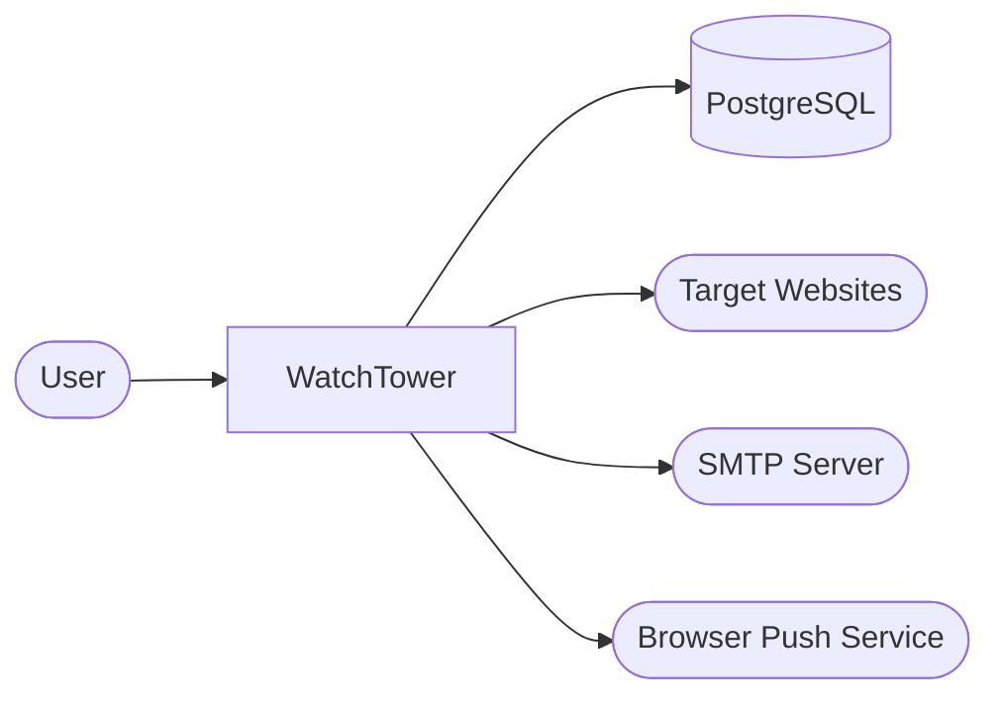

### External Systems

| External System | Purpose |
|-----------------|---------|
| PostgreSQL | Stores persistent application data. |
| Target Websites | Provide the information monitored by WatchTower. |
| SMTP Server | Delivers email notifications. |
| Browser Push Service | Delivers browser notifications. |

---

## 4.3 High-Level Architecture

The internal organization of WatchTower is divided into five logical architectural layers.

Each layer has a clearly defined responsibility and communicates only with adjacent layers.

### High-Level Architecture Diagram

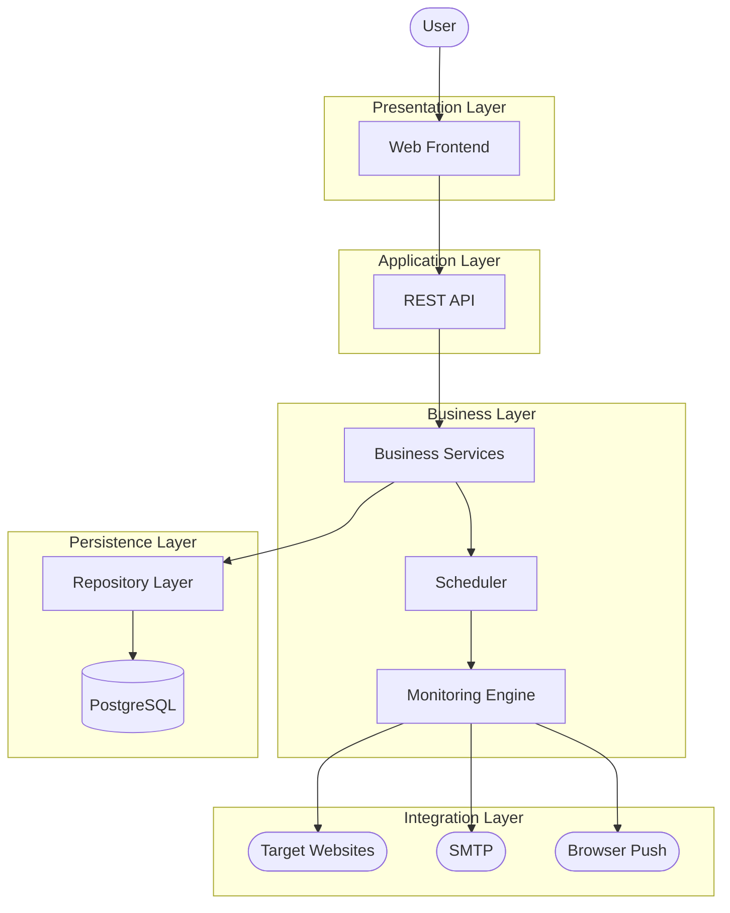

### Layer Responsibilities

| Layer | Responsibility |
|--------|----------------|
| Presentation Layer | User interaction and interface rendering. |
| Application Layer | Request handling and API exposure. |
| Business Layer | Business logic, monitoring execution, scheduling, and notifications. |
| Persistence Layer | Data access and storage. |
| Integration Layer | Communication with external websites and notification providers. |

---

## 4.4 Architectural Communication

The architectural layers communicate according to the following rules.

### User Request Flow

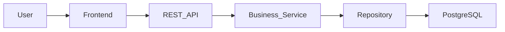


This flow represents standard user-initiated operations such as authentication, task management, profile updates, and dashboard retrieval.

---

### Monitoring Execution Flow

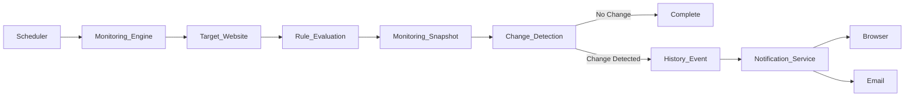


This workflow represents the autonomous monitoring cycle executed by WatchTower independently of user interaction.

---

## 4.5 Communication Principles

To preserve architectural integrity, the following communication principles shall be observed.

| Principle | Description |
|------------|-------------|
| CP-001 | The Presentation Layer communicates exclusively through the REST API. |
| CP-002 | Business logic shall reside only within the Business Layer. |
| CP-003 | Database access shall occur exclusively through the Repository Layer. |
| CP-004 | External systems communicate only with the Business Layer. |
| CP-005 | Monitoring execution remains independent of notification delivery. |

---

## 4.6 Architectural Characteristics

The selected architecture provides several important quality attributes.

### Separation of Concerns

Each architectural layer is responsible for a distinct aspect of the application.

### Loose Coupling

Components communicate through clearly defined interfaces, reducing interdependencies.

### High Cohesion

Each module performs a focused responsibility within its respective layer.

### Extensibility

Future monitoring strategies, notification providers, and integration services can be introduced with minimal impact on existing components.

### Reliability

Independent execution paths prevent localized failures from affecting unrelated application functionality.

### Maintainability

The layered organization promotes readable code, simplified debugging, and modular development.

---

## 4.7 Design Rationale

The architecture of WatchTower was intentionally designed around its monitoring workflow rather than conventional CRUD application patterns.

Monitoring execution, change detection, and notification delivery are treated as independent responsibilities coordinated by the Business Layer.

This organization reflects the operational nature of the application while providing flexibility for future enhancements such as additional monitoring engines, notification providers, distributed scheduling, and advanced analytics.

---

## Chapter Summary

This chapter introduced the architectural foundation of WatchTower by presenting its architectural style, system context, high-level organization, communication model, and guiding design decisions.

The following chapter expands this view by decomposing the Business Layer into its internal components and describing how those components collaborate during system execution.

# 5. Component Architecture

---

## Chapter Overview

This chapter describes the internal architecture of the WatchTower backend by decomposing it into logical components and defining the responsibility of each component.

The objective is to ensure that every component has a single responsibility and communicates only with components it is intended to interact with.

The component architecture follows the architectural principles defined in Chapter 3.

---

## 5.1 Component Overview

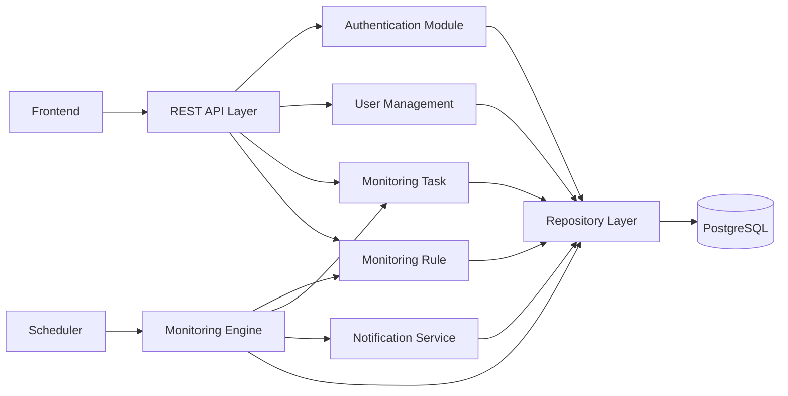


---

## 5.2 Component Responsibilities

| Component | Responsibility |
|------------|----------------|
| REST API Layer | Accepts HTTP requests and returns HTTP responses. |
| Authentication Module | User authentication and authorization. |
| User Management | User profile and account management. |
| Monitoring Task | Lifecycle management of monitoring tasks. |
| Monitoring Rule | Rule configuration and validation. |
| Scheduler | Periodically triggers monitoring execution. |
| Monitoring Engine | Executes monitoring workflow. |
| Notification Service | Generates and delivers notifications. |
| Repository Layer | Handles all database operations. |

---

## 5.3 Dependency Rules

To maintain architectural integrity, the following dependency rules shall be observed.

### Allowed Dependencies

Frontend

↓

REST API

↓

Business Services

↓

Repository Layer

↓

Database

---

### Forbidden Dependencies

The following interactions are not permitted.

❌ Frontend → Database

❌ Scheduler → Database

❌ Monitoring Engine → SMTP

❌ Monitoring Engine → Browser Push API

❌ Notification Service → Frontend

❌ Repository Layer → REST API

---

## 5.4 Component Communication

Components communicate using direct service calls within the backend.

External communication occurs only through:

- REST APIs
- Browser Push Service
- SMTP Server

Database communication shall occur exclusively through the Repository Layer.

---

## 5.5 Design Rationale

The component architecture minimizes coupling while maximizing modularity.

Each component performs one clearly defined responsibility and communicates only with neighboring architectural layers.

This organization simplifies testing, debugging, and future maintenance while supporting incremental feature expansion.

# 6. Backend Package Structure

---

## Chapter Overview

The backend package structure organizes the WatchTower codebase into logical modules based on responsibility.

This organization promotes maintainability, testability, and scalability while supporting independent development of major application features.

---

## 6.1 Package Structure

```text
backend/

└── app/

    ├── api/
    │   ├── auth.py
    │   ├── users.py
    │   ├── tasks.py
    │   ├── rules.py
    │   ├── history.py
    │   ├── notifications.py
    │   └── settings.py
    │
    ├── core/
    │   ├── config.py
    │   ├── security.py
    │   └── dependencies.py
    │
    ├── models/
    │
    ├── schemas/
    │
    ├── repositories/
    │
    ├── services/
    │
    ├── monitoring/
    │
    ├── scheduler/
    │
    ├── notifications/
    │
    ├── database/
    │
    ├── utils/
    │
    └── main.py
```

---

## 6.2 Layer Responsibilities

| Package | Responsibility |
|----------|----------------|
| api | HTTP endpoints |
| core | Configuration and security |
| models | SQLAlchemy entities |
| schemas | Request and response models |
| repositories | Database operations |
| services | Business logic |
| monitoring | Monitoring Engine implementation |
| scheduler | APScheduler integration |
| notifications | Notification providers |
| database | Database initialization |
| utils | Shared helper functions |

---

## 6.3 Architectural Rules

Business logic shall never be implemented inside API endpoints.

Repositories shall not contain business rules.

Models shall represent persistence only.

Schemas shall represent API contracts only.

The Monitoring Engine shall remain independent of notification provider implementations.

---

## 6.4 Package Dependencies

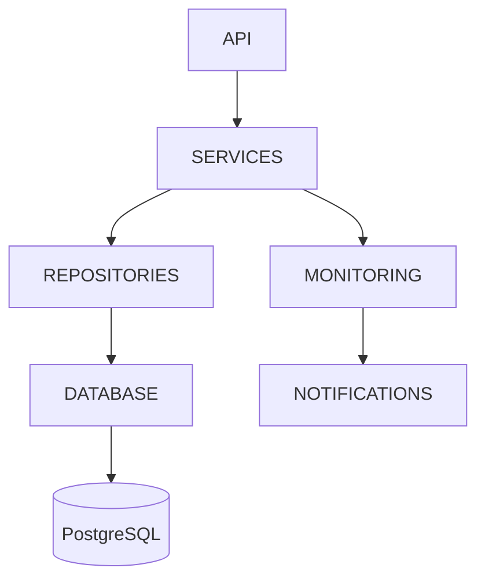


---

## Design Rationale

The package organization follows a layered architecture in which responsibilities remain isolated and dependencies remain predictable.

This organization enables independent testing of individual layers while simplifying future expansion.

# 7. Data Architecture

---

## Chapter Overview

This chapter defines the logical data architecture of WatchTower and describes how business data is created, processed, stored, maintained, and retired throughout the system.

Unlike the **Database Design Document (DDD)**, which specifies the physical database schema, this chapter focuses on the architectural management of data, including ownership, movement, persistence, transactional behavior, and lifecycle.

The objective of the data architecture is to ensure consistency, maintainability, scalability, and efficient long-term operation while preserving the integrity of monitoring information.

---

# 7.1 Data Ownership

Every business entity within WatchTower is owned by exactly one architectural component.

A component that owns an entity is solely responsible for creating, modifying, validating, and deleting that entity. Other components may access the entity only through the owning component's public interfaces.

This ownership model reduces coupling, prevents conflicting responsibilities, and simplifies future maintenance.

## Entity Ownership Matrix

| Business Entity | Owning Component | Primary Responsibility |
|-----------------|------------------|------------------------|
| User | Authentication Service | Identity and account management |
| Monitoring Task | Monitoring Service | Monitoring task lifecycle |
| Monitoring Rule | Monitoring Service | Rule configuration and validation |
| Monitoring Snapshot | Monitoring Engine | Runtime observation recording |
| History Event | Monitoring Engine | Permanent monitoring history |
| Notification Preference | Notification Service | Notification configuration |
| Notification | Notification Service | Notification generation and delivery |

### Data Ownership Principles

- Every entity shall have a single architectural owner.
- Business entities shall not be modified outside their owning component.
- Components shall communicate through service interfaces rather than directly manipulating foreign entities.
- Data ownership shall remain consistent throughout the application lifecycle.

---

# 7.2 Logical Data Flow

Business data flows through the architectural layers in a controlled and predictable manner.

All user-initiated requests follow the same processing pipeline regardless of functionality.

## User Request Data Flow

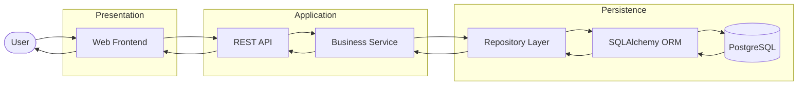


### Flow Description

1. The user initiates an operation through the web interface.
2. The frontend submits the request to the REST API.
3. The API forwards the request to the appropriate business service.
4. Business services perform validation and business logic.
5. Repository components execute persistence operations.
6. SQLAlchemy manages communication with PostgreSQL.
7. The response follows the reverse path back to the user.

---

# 7.3 Monitoring Data Lifecycle

Unlike user-driven operations, monitoring execution occurs autonomously through the scheduler.

The following diagram illustrates how monitoring data progresses from observation to permanent business history.

## Monitoring Data Lifecycle

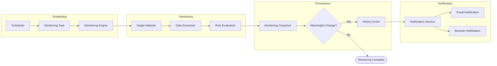


### Lifecycle Description

1. The Scheduler initiates execution of an active Monitoring Task.
2. The Monitoring Engine retrieves the target resource.
3. Required information is extracted from the monitored webpage.
4. Active Monitoring Rules evaluate the extracted information.
5. The observed state is recorded as a Monitoring Snapshot.
6. The Monitoring Engine determines whether a meaningful change has occurred.
7. If no change is detected, the monitoring cycle ends.
8. If a meaningful change is detected, a History Event is created.
9. The Notification Service generates notifications according to user preferences.

---

# 7.4 Persistence Strategy

WatchTower adopts a layered persistence strategy that separates business logic from database access.

The Repository Layer acts as the exclusive gateway between business services and the database.

## Persistence Architecture

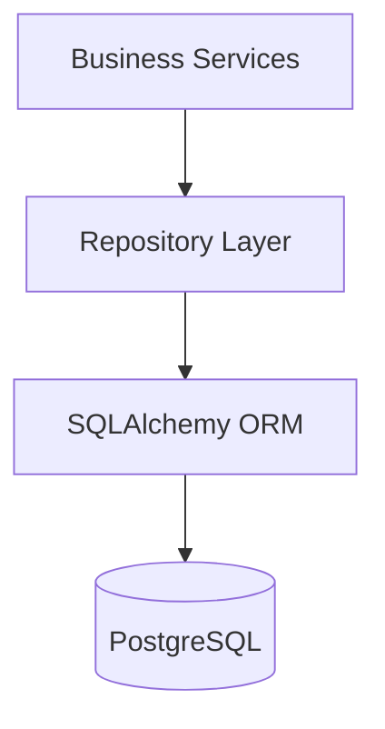


### Persistence Principles

- Business services shall never execute SQL statements directly.
- Database access shall occur exclusively through repositories.
- SQLAlchemy ORM shall manage entity persistence.
- Repository classes shall contain persistence logic only.
- Business validation shall remain within the service layer.
- API schemas shall remain independent of persistence models.

---

# 7.5 Transaction Management

Different business operations require different transactional behavior.

User operations prioritize atomicity, while monitoring operations prioritize continuity.

## User Transaction Flow

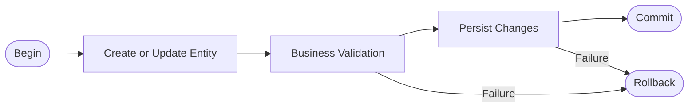


All user-initiated operations shall execute as a single logical transaction.

If any step fails, all intermediate changes shall be rolled back.

---

## Monitoring Transaction Flow

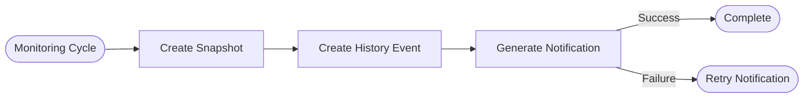


Monitoring execution shall prioritize preserving monitoring data.

Notification delivery failures shall not invalidate completed monitoring observations.

### Transaction Principles

- User operations shall be atomic.
- Monitoring execution shall preserve completed observations.
- Notification failures shall be recoverable.
- Business history shall never be lost due to notification failures.

---

# 7.6 Data Retention Strategy

Different business entities have different retention requirements.

Operational data may be removed after it becomes obsolete, whereas business history must remain available.

## Data Retention Lifecycle

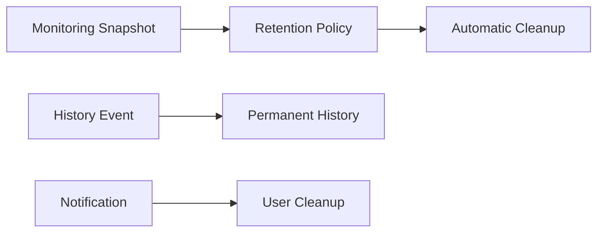


## Retention Policy

| Entity | Retention Strategy |
|----------|--------------------|
| Monitoring Snapshot | Limited according to configured retention policy |
| History Event | Retained permanently until the associated Monitoring Task is removed |
| Notification | Managed by the user |
| Monitoring Task | Managed by the user |
| Monitoring Rule | Managed by the user |

### Retention Principles

- Operational data may be automatically removed.
- Business history shall remain available.
- Storage growth shall remain predictable.
- Automatic cleanup shall never remove meaningful monitoring history.

---

# 7.7 Architectural Decisions

| ID | Decision | Rationale |
|----|----------|-----------|
| AD-DA-001 | Monitoring Snapshots are temporary operational records. | Minimizes long-term database growth. |
| AD-DA-002 | History Events represent permanent business records. | Preserves an auditable monitoring history. |
| AD-DA-003 | Notifications reference History Events rather than Monitoring Snapshots. | Separates business events from runtime observations. |
| AD-DA-004 | Repository Layer exclusively owns persistence operations. | Enforces separation of concerns. |
| AD-DA-005 | Every business entity has a single architectural owner. | Prevents conflicting responsibilities and improves maintainability. |
| AD-DA-006 | Monitoring data and user operations follow different transaction strategies. | Maximizes reliability while preserving important business information. |

---

# 7.8 Chapter Summary

This chapter defined the logical data architecture of WatchTower by establishing ownership boundaries, data flow, persistence strategy, transaction management, and data retention policies.

The architecture distinguishes operational monitoring data from permanent business history, ensuring efficient storage management while preserving meaningful monitoring events.

The next chapter expands upon this foundation by describing the Runtime Architecture, illustrating how WatchTower components collaborate during application execution.

# 8. Runtime Architecture

---

## Chapter Overview

This chapter describes the runtime behavior of WatchTower by illustrating how its architectural components collaborate during application execution.

Unlike previous chapters, which focused on static architecture and data organization, this chapter explains the dynamic behavior of the system. It defines the execution lifecycle of user requests, monitoring operations, scheduler activities, notification delivery, and failure recovery.

The Runtime Architecture ensures that all system processes remain predictable, resilient, and aligned with the architectural principles established in earlier chapters.

---

# 8.1 Runtime Overview

WatchTower operates using two independent execution models:

- **Interactive Execution**, initiated by user requests.
- **Autonomous Execution**, initiated by the Scheduler.

These execution models operate independently while sharing the same business services and persistence infrastructure.

## Runtime Architecture Overview

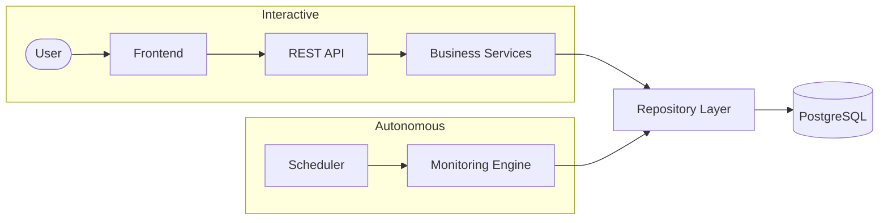


---

# 8.2 Interactive Request Lifecycle

Interactive execution represents all operations initiated directly by authenticated users.

Typical examples include:

- User authentication
- Creating monitoring tasks
- Updating monitoring rules
- Viewing monitoring history
- Managing notifications
- Updating account settings

## Interactive Request Flow

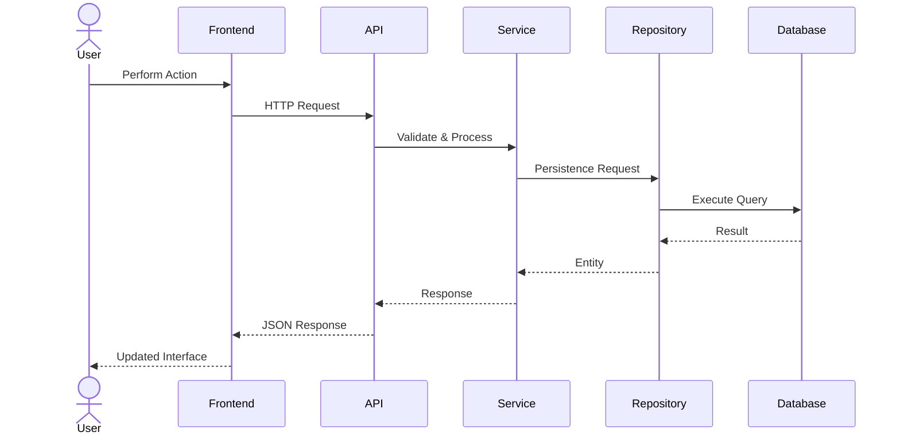


### Runtime Characteristics

- Request-driven execution
- Short-lived processing
- Immediate user response
- Atomic business operations

---

# 8.3 Scheduler Lifecycle

The Scheduler is responsible for initiating monitoring activities without user interaction.

It periodically evaluates eligible Monitoring Tasks and delegates execution to the Monitoring Engine.

## Scheduler Execution Flow

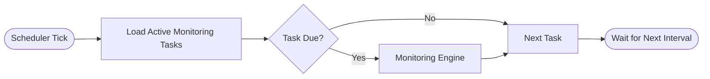


### Scheduler Responsibilities

- Identify active monitoring tasks.
- Determine execution eligibility.
- Trigger monitoring execution.
- Continue processing remaining tasks regardless of individual task failures.

---

# 8.4 Monitoring Execution Lifecycle

The Monitoring Engine performs the core business function of WatchTower.

Each Monitoring Task follows the same execution pipeline.

## Monitoring Runtime Flow

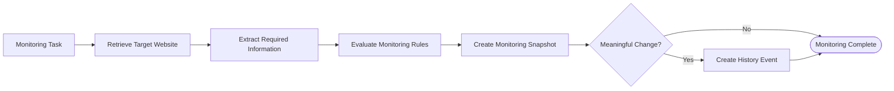


### Execution Principles

- Every Monitoring Task executes independently.
- Every successful execution produces one Monitoring Snapshot.
- History Events are generated only when meaningful changes are detected.
- Monitoring execution remains independent of notification delivery.

---

# 8.5 Notification Lifecycle

Notifications are generated only after a History Event has been successfully recorded.

Notification delivery is intentionally separated from monitoring execution.

## Notification Runtime Flow

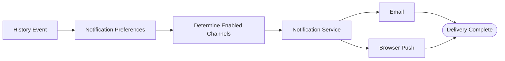


### Notification Principles

- Notifications originate exclusively from History Events.
- Multiple notification channels may be used simultaneously.
- Notification providers remain interchangeable.
- Delivery failures do not invalidate monitoring execution.

---

# 8.6 Failure Recovery

WatchTower is designed to isolate failures and maximize application availability.

Failures occurring within one execution path shall not interrupt unrelated system activities.

## Failure Recovery Flow

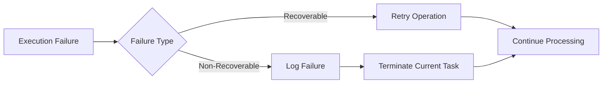


### Failure Recovery Principles

- Monitoring failures shall affect only the current Monitoring Task.
- Notification failures shall not invalidate completed monitoring cycles.
- Unexpected exceptions shall be logged.
- Scheduler execution shall continue after recoverable failures.

---

# 8.7 Runtime State Transitions

Monitoring Tasks transition between a limited number of runtime states.

## Monitoring Task State Diagram

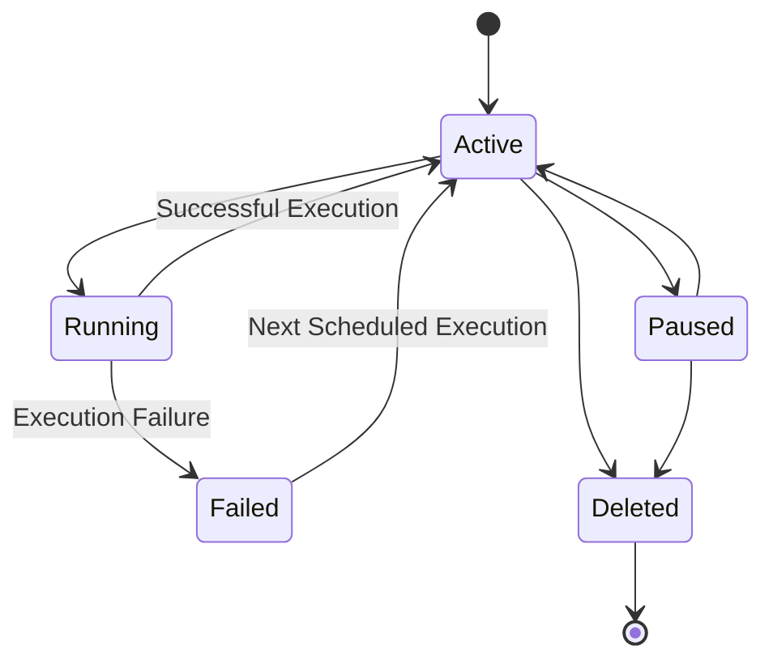

### State Definitions

| State | Description |
|---------|-------------|
| Active | Eligible for scheduled execution. |
| Running | Currently being processed by the Monitoring Engine. |
| Failed | Most recent execution was unsuccessful. |
| Paused | Temporarily excluded from monitoring. |
| Deleted | Permanently removed from the system. |

---

# 8.8 Runtime Characteristics

The runtime architecture exhibits the following characteristics:

### Concurrent Processing

Independent Monitoring Tasks may execute concurrently where supported by the implementation.

### Fault Isolation

Failures remain isolated to the affected execution path.

### Stateless Request Processing

Interactive requests remain stateless except for authenticated user context.

### Asynchronous Monitoring

Monitoring execution operates independently of user interaction.

### Event-Driven Notification

Notifications are triggered by History Events rather than direct monitoring outcomes.

---

# 8.9 Architectural Decisions

| ID | Decision | Rationale |
|----|----------|-----------|
| AD-RT-001 | Interactive and autonomous execution remain independent. | Prevents user activity from affecting monitoring operations. |
| AD-RT-002 | Monitoring execution always creates a Monitoring Snapshot before evaluating business events. | Preserves runtime observations. |
| AD-RT-003 | Notifications originate from History Events. | Reduces coupling between monitoring and notification systems. |
| AD-RT-004 | Scheduler failures shall not interrupt future monitoring cycles. | Improves long-term reliability. |
| AD-RT-005 | Monitoring Tasks execute independently. | Supports scalability and fault isolation. |

---

# 8.10 Chapter Summary

This chapter described the runtime behavior of WatchTower by defining the execution lifecycle of interactive requests, scheduled monitoring, notification delivery, and failure recovery.

The Runtime Architecture complements the static architecture presented in previous chapters by illustrating how WatchTower components collaborate during execution while maintaining reliability, modularity, and fault isolation.

The following chapter describes the Security Architecture, which defines the mechanisms used to protect application resources, user data, and system integrity.

# 9. Security Architecture

---

## Chapter Overview

This chapter defines the security architecture of WatchTower and describes the mechanisms employed to protect user accounts, business data, application resources, and external communications.

The security architecture follows the principle of **defense in depth**, implementing multiple layers of protection rather than relying on a single security mechanism. Authentication, authorization, data protection, secure communication, and error handling collectively contribute to maintaining the confidentiality, integrity, and availability of the system.

---

# 9.1 Security Objectives

The security architecture of WatchTower is designed to achieve the following objectives:

- Protect user accounts and credentials.
- Prevent unauthorized access to application resources.
- Ensure data confidentiality during transmission.
- Preserve the integrity of monitoring information.
- Prevent unauthorized modification of business data.
- Maintain secure communication with external services.
- Minimize information disclosure during failures.

---

# 9.2 Security Layers

Security is implemented across multiple architectural layers.

## Security Layer Overview

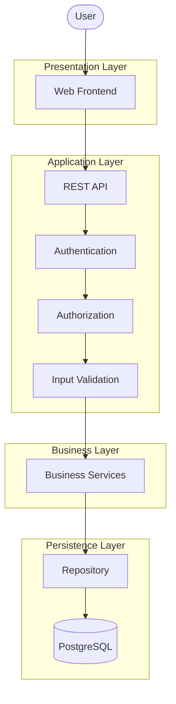


### Layer Responsibilities

| Layer | Responsibility |
|--------|----------------|
| Presentation Layer | Secure user interaction and session management |
| Application Layer | Authentication, authorization, validation, and request processing |
| Business Layer | Business rule enforcement |
| Persistence Layer | Secure data storage and controlled database access |

---

# 9.3 Authentication

Authentication verifies the identity of users before allowing access to protected application resources.

## Authentication Flow

```mermaid
sequenceDiagram

actor User

participant Frontend

participant API

participant Authentication

participant Database

User->>Frontend: Login Credentials

Frontend->>API: Authentication Request

API->>Authentication: Validate Credentials

Authentication->>Database: Retrieve User

Database-->>Authentication: User Record

Authentication-->>API: Authentication Result

API-->>Frontend: JWT Token

Frontend-->>User: Login Successful
```


### Authentication Principles

- Users shall authenticate using registered credentials.
- Passwords shall never be stored in plaintext.
- Passwords shall be securely hashed using bcrypt.
- JWT shall be used for authenticated API access.
- Authentication tokens shall expire after a configurable period.

---

# 9.4 Authorization

Authorization determines whether an authenticated user is permitted to perform a requested operation.

WatchTower follows a resource ownership model.

Users may access only resources associated with their own account.

## Authorization Model

```mermaid
flowchart LR

REQUEST[User Request]

AUTH[Authenticated?]

OWNER{Resource Owner?}

ALLOW([Access Granted])

DENY([Access Denied])

REQUEST --> AUTH

AUTH -->|No| DENY

AUTH -->|Yes| OWNER

OWNER -->|Yes| ALLOW

OWNER -->|No| DENY
```


### Authorization Principles

- Every protected request requires authentication.
- Resource ownership shall be verified before performing operations.
- Unauthorized requests shall be rejected.
- Administrative functionality is outside the scope of Version 1.0.

---

# 9.5 Data Protection

Sensitive information shall be protected both during transmission and while stored within the application.

### Protected Data

- User passwords
- Authentication tokens
- User profile information
- Notification preferences
- Monitoring configurations

### Data Protection Measures

| Asset | Protection Mechanism |
|--------|----------------------|
| Passwords | bcrypt hashing |
| Authentication Tokens | JWT |
| Database Access | Repository Layer |
| API Communication | HTTPS |
| User Resources | Ownership validation |

---

# 9.6 Input Validation

All external input shall be validated before processing.

Validation occurs at multiple levels.

## Validation Flow

```mermaid
flowchart LR

INPUT[Client Request]

FORMAT[Format Validation]

BUSINESS[Business Validation]

PROCESS[Business Processing]

REJECT([Validation Error])

INPUT --> FORMAT

FORMAT -->|Invalid| REJECT

FORMAT -->|Valid| BUSINESS

BUSINESS -->|Invalid| REJECT

BUSINESS -->|Valid| PROCESS
```


### Validation Principles

- Invalid requests shall be rejected immediately.
- Business validation shall occur before persistence.
- Validation errors shall not expose internal implementation details.
- User input shall never be trusted implicitly.

---

# 9.7 External Communication Security

WatchTower communicates with multiple external systems during monitoring and notification delivery.

These communications shall be performed securely.

## External Communication

```mermaid
flowchart LR

APP[WatchTower]

WEB[Target Websites]

SMTP[SMTP Server]

PUSH[Browser Push Service]

APP --> WEB

APP --> SMTP

APP --> PUSH
```


### Communication Principles

- External communications shall use secure protocols where available.
- Failures during external communication shall be isolated.
- Sensitive credentials shall be stored securely within application configuration.
- External service failures shall not compromise application integrity.

---

# 9.8 Error and Exception Security

Application errors shall be handled in a secure manner.

Internal implementation details shall never be exposed through user-facing error messages.

### Error Handling Principles

- Unexpected exceptions shall be logged.
- Stack traces shall never be returned to clients.
- Sensitive configuration information shall not appear in logs.
- Error responses shall remain consistent across the application.

---

# 9.9 Security Characteristics

The security architecture exhibits the following characteristics.

### Authentication

Identity verification before protected resource access.

### Authorization

Resource ownership enforcement.

### Confidentiality

Sensitive information protected during storage and transmission.

### Integrity

Business data protected against unauthorized modification.

### Availability

Failures handled without compromising application operation.

### Least Privilege

Users receive only the permissions required to perform authorized actions.

---

# 9.10 Architectural Decisions

| ID | Decision | Rationale |
|----|----------|-----------|
| AD-SEC-001 | JWT is used for API authentication. | Supports stateless authentication. |
| AD-SEC-002 | Passwords are stored only as bcrypt hashes. | Protects user credentials. |
| AD-SEC-003 | Repository Layer exclusively accesses the database. | Prevents unauthorized persistence operations. |
| AD-SEC-004 | Authorization is based on resource ownership. | Simplifies access control for Version 1.0. |
| AD-SEC-005 | Internal exceptions are never exposed to clients. | Reduces information disclosure risks. |

---

# 9.11 Chapter Summary

This chapter described the Security Architecture of WatchTower by defining authentication, authorization, data protection, validation, external communication security, and secure error handling.

These security mechanisms collectively ensure that application resources remain protected while maintaining the modular and layered architecture established throughout this document.

The following chapter describes the Deployment Architecture, explaining how WatchTower is deployed and how its architectural components interact within the runtime environment.

# 10. Deployment Architecture

---

## Chapter Overview

This chapter describes the deployment architecture of WatchTower and defines how the application's software components are organized within the runtime environment.

The deployment architecture identifies the physical deployment units, execution environment, infrastructure dependencies, and communication paths between deployed components. It also establishes the deployment strategy adopted for Version 1.0 while providing architectural flexibility for future scaling.

---

# 10.1 Deployment Objectives

The deployment architecture has been designed with the following objectives:

- Simple deployment and maintenance.
- Clear separation between frontend, backend, and database.
- Secure communication between architectural components.
- Support for local development and cloud deployment.
- Future scalability without major architectural changes.

---

# 10.2 Deployment Overview

Version 1.0 of WatchTower follows a three-tier deployment architecture consisting of:

- Presentation Tier
- Application Tier
- Data Tier

External services are integrated independently of the core deployment.

## Deployment Overview Diagram

```mermaid
flowchart TB

USER([User])

subgraph Client Tier
BROWSER[Web Browser]
end

subgraph Application Tier
BACKEND[FastAPI Application]
SCHED[Background Scheduler]
end

subgraph Data Tier
DB[(PostgreSQL)]
end

subgraph External Services
WEB[Target Websites]
SMTP[SMTP Server]
PUSH[Browser Push Service]
end

USER --> BROWSER

BROWSER --> BACKEND

BACKEND --> DB

SCHED --> WEB

BACKEND --> SMTP

BACKEND --> PUSH
```


---

# 10.3 Deployment Components

## Client Tier

The Client Tier provides the user interface through a modern web browser.

### Responsibilities

- Display application interface
- Send API requests
- Receive API responses
- Display notifications
- Manage authenticated user sessions

---

## Application Tier

The Application Tier hosts the core business logic of WatchTower.

### Responsibilities

- Process REST API requests
- Execute business services
- Manage authentication
- Execute scheduled monitoring
- Deliver notifications
- Coordinate database operations

---

## Data Tier

The Data Tier consists of a PostgreSQL database responsible for persistent storage.

### Responsibilities

- Store business entities
- Maintain monitoring history
- Persist notification records
- Store monitoring configurations

---

## External Services

External systems provide functionality outside the application's deployment boundary.

### External Dependencies

| Service | Purpose |
|----------|---------|
| Target Websites | Source of monitored information |
| SMTP Server | Email delivery |
| Browser Push Service | Browser notification delivery |

---

# 10.4 Deployment Communication

Communication between deployment components follows controlled architectural boundaries.

## Communication Diagram

```mermaid
flowchart LR

Browser

-->

REST_API

-->

Business_Services

-->

Repository

-->

PostgreSQL

Business_Services

-->

Target_Websites

Business_Services

-->

SMTP

Business_Services

-->

Browser_Push
```


### Communication Principles

- Clients communicate only through HTTPS REST APIs.
- Database communication occurs exclusively through the Repository Layer.
- External services never access internal application resources directly.
- Background monitoring executes independently of user requests.

---

# 10.5 Runtime Environment

The following runtime environment is required for Version 1.0.

| Component | Technology |
|-----------|------------|
| Frontend | HTML, CSS, JavaScript |
| Backend | FastAPI |
| Language | Python |
| ORM | SQLAlchemy |
| Database | PostgreSQL |
| Scheduler | APScheduler |
| Notification | SMTP, Browser Push |
| Web Server | Uvicorn |

---

# 10.6 Deployment Strategy

Version 1.0 adopts a monolithic deployment strategy.

All application components execute within a single backend application while maintaining logical separation through modular architecture.

## Monolithic Deployment

```mermaid
flowchart TB

subgraph WatchTower Application

API[REST API]

AUTH[Authentication]

MONITOR[Monitoring]

NOTIFY[Notification]

SCHED[Scheduler]

REPO[Repository]

end

DB[(PostgreSQL)]

API --> AUTH

API --> MONITOR

MONITOR --> NOTIFY

MONITOR --> SCHED

AUTH --> REPO

MONITOR --> REPO

NOTIFY --> REPO

REPO --> DB
```


### Deployment Principles

- Components remain logically independent.
- Deployment remains operationally simple.
- Future migration toward distributed deployment remains possible.

---

# 10.7 Scalability Considerations

Although Version 1.0 targets a single application deployment, the architecture supports future scaling.

Potential scalability improvements include:

- Multiple backend instances.
- Dedicated monitoring workers.
- Distributed scheduler.
- Message queue integration.
- Load balancing.
- Independent notification workers.

These enhancements can be introduced without altering the architectural principles established in this document.

---

# 10.8 Availability and Reliability

The deployment architecture incorporates several mechanisms to improve reliability.

### Reliability Principles

- Monitoring failures shall not terminate the application.
- Scheduler failures shall not corrupt persisted data.
- Notification failures shall not invalidate monitoring history.
- Database failures shall be reported gracefully.
- Application logs shall support operational diagnostics.

---

# 10.9 Architectural Decisions

| ID | Decision | Rationale |
|----|----------|-----------|
| AD-DEP-001 | Version 1.0 adopts a monolithic deployment architecture. | Simplifies deployment and maintenance. |
| AD-DEP-002 | PostgreSQL is deployed independently from the application server. | Improves data isolation and maintainability. |
| AD-DEP-003 | Scheduler executes within the application process. | Reduces deployment complexity for Version 1.0. |
| AD-DEP-004 | External services remain outside the deployment boundary. | Preserves loose coupling and implementation flexibility. |
| AD-DEP-005 | Logical modularity is maintained despite monolithic deployment. | Enables future architectural evolution. |

---

# 10.10 Chapter Summary

This chapter described the Deployment Architecture of WatchTower by defining its deployment topology, runtime environment, communication pathways, deployment strategy, and scalability considerations.

The selected deployment architecture provides a simple yet extensible foundation for Version 1.0 while preserving clear architectural boundaries and supporting future growth.

The next chapter documents the key architectural decisions that influenced the design of WatchTower and explains the rationale behind those decisions.

# 11. Architectural Decisions

---

## Chapter Overview

This chapter documents the significant architectural decisions made during the design of WatchTower. Each decision captures not only *what* was chosen but also *why* it was chosen, including the trade-offs considered during the design process.

These decisions form the architectural baseline of the project and should guide future development. Any deviation from these decisions should be evaluated carefully and documented to preserve architectural consistency.

---

# 11.1 Purpose

Architectural decisions provide a historical record of the reasoning behind the system design.

The objectives of documenting these decisions are to:

- Preserve architectural knowledge.
- Ensure consistency during implementation.
- Support future maintenance and enhancements.
- Prevent repeated architectural debates.
- Explain design trade-offs to future contributors.

---

# 11.2 Decision Log

The following Architectural Decision Records (ADRs) summarize the most significant design choices made during the development of WatchTower.

---

## ADR-001 — Layered Architecture

### Decision

WatchTower adopts a Layered Architecture consisting of the Presentation, Application, Business, Persistence, and Integration layers.

### Rationale

A layered architecture provides clear separation of concerns, simplifies maintenance, improves testability, and allows independent evolution of application components.

### Consequences

#### Advantages

- Clear architectural boundaries.
- Simplified debugging.
- Improved maintainability.
- Better scalability.

#### Trade-offs

- Additional abstraction layers.
- Slightly increased implementation complexity.

---

## ADR-002 — Service-Oriented Business Layer

### Decision

Business logic shall reside exclusively within dedicated service components.

### Rationale

Separating business logic from API controllers and repositories improves code organization and promotes reuse.

### Consequences

#### Advantages

- Cleaner APIs.
- Reusable business logic.
- Easier unit testing.

#### Trade-offs

- Additional service classes.
- More explicit dependency management.

---

## ADR-003 — Repository Pattern

### Decision

Database access shall be performed exclusively through repository classes.

### Rationale

Repositories isolate persistence logic from business logic and prevent direct database access by higher architectural layers.

### Consequences

#### Advantages

- Improved separation of concerns.
- Easier migration between persistence technologies.
- Simplified testing through repository abstraction.

#### Trade-offs

- Additional abstraction layer.

---

## ADR-004 — Monitoring Task as Aggregate Root

### Decision

The Monitoring Task serves as the aggregate root of the monitoring domain.

### Rationale

Monitoring Rules, Monitoring Snapshots, History Events, and Notifications all exist in the context of a Monitoring Task.

This central ownership simplifies lifecycle management and maintains consistency across monitoring-related entities.

### Consequences

#### Advantages

- Consistent ownership model.
- Simplified cascading operations.
- Clear domain boundaries.

---

## ADR-005 — Separation of Operational Data and Business History

### Decision

Monitoring Snapshots and History Events are stored as separate entities.

### Rationale

Monitoring Snapshots represent temporary operational observations, while History Events represent permanent business events.

Separating these responsibilities allows snapshot cleanup without affecting long-term monitoring history.

### Consequences

#### Advantages

- Reduced database growth.
- Permanent audit history.
- Independent retention policies.

#### Trade-offs

- Additional entity relationships.

---

## ADR-006 — Event-Driven Notification

### Decision

Notifications are generated from History Events rather than directly from the Monitoring Engine.

### Rationale

Separating monitoring execution from notification delivery minimizes coupling and simplifies future integration of additional notification providers.

### Consequences

#### Advantages

- Loose coupling.
- Improved extensibility.
- Independent notification processing.

---

## ADR-007 — Independent Rule Evaluation

### Decision

Each Monitoring Rule shall execute independently during every monitoring cycle.

### Rationale

Independent rule evaluation prevents one rule from affecting the execution or outcome of another.

### Consequences

#### Advantages

- Fault isolation.
- Flexible monitoring strategies.
- Easier feature expansion.

---

## ADR-008 — Snapshot Retention Policy

### Decision

Monitoring Snapshots shall be retained only up to a configurable retention limit.

### Rationale

Snapshots are operational records used for comparison during monitoring execution.

Retaining unlimited snapshots would unnecessarily increase storage requirements.

### Consequences

#### Advantages

- Predictable database growth.
- Reduced storage requirements.
- Improved long-term performance.

---

## ADR-009 — Monolithic Deployment

### Decision

Version 1.0 shall be deployed as a modular monolithic application.

### Rationale

A modular monolith provides the simplicity of a single deployment while preserving logical separation between components.

### Consequences

#### Advantages

- Easier deployment.
- Simplified debugging.
- Lower operational overhead.

#### Trade-offs

- Limited independent scaling of individual modules.

---

## ADR-010 — JWT-Based Authentication

### Decision

WatchTower shall use JWT for API authentication.

### Rationale

JWT enables stateless authentication suitable for RESTful applications while reducing server-side session management.

### Consequences

#### Advantages

- Stateless authentication.
- Simplified scaling.
- Standardized API security.

---

# 11.3 Architectural Principles Mapping

The following table illustrates how major architectural decisions support the architectural principles established earlier in this document.

| Architectural Principle | Supporting Decisions |
|--------------------------|----------------------|
| Single Responsibility | ADR-002, ADR-003 |
| Separation of Concerns | ADR-001, ADR-003 |
| Modularity | ADR-001, ADR-009 |
| Event-Driven Processing | ADR-006 |
| Task-Centric Domain Model | ADR-004 |
| Independent Rule Evaluation | ADR-007 |
| Fault Isolation | ADR-007, ADR-009 |
| Extensibility | ADR-001, ADR-006, ADR-009 |

---

# 11.4 Decision Impact Analysis

The architectural decisions documented in this chapter collectively influence several aspects of the system.

| Area | Architectural Impact |
|------|----------------------|
| Maintainability | Clear module boundaries simplify maintenance. |
| Scalability | Layered design supports future expansion. |
| Reliability | Fault isolation minimizes cascading failures. |
| Performance | Snapshot retention controls database growth. |
| Extensibility | Modular services simplify feature additions. |
| Testability | Independent services improve unit and integration testing. |

---

# 11.5 Future Decision Process

Future architectural decisions shall follow the same documentation process adopted in this chapter.

Each new Architectural Decision Record (ADR) should include:

- Decision Identifier
- Decision Statement
- Context
- Rationale
- Alternatives Considered
- Consequences
- Date of Adoption

This ensures that the architectural evolution of WatchTower remains transparent, traceable, and consistent.

---

# 11.6 Chapter Summary

This chapter documented the key architectural decisions that define the structure and behavior of WatchTower. These decisions establish the architectural foundation of the application and provide the reasoning behind major design choices.

Future enhancements should respect these decisions or formally document any approved deviations through additional Architectural Decision Records.

# 12. Future Extensibility

---

## Chapter Overview

This chapter describes how the architecture of WatchTower supports future growth without requiring significant redesign of the existing system.

One of the primary architectural goals of WatchTower is extensibility. Version 1.0 intentionally focuses on delivering a stable monitoring platform while establishing architectural extension points that enable future capabilities to be integrated with minimal impact on existing components.

The extensibility strategy emphasizes modularity, loose coupling, and adherence to the architectural principles defined earlier in this document.

---

# 12.1 Extensibility Objectives

The architecture has been designed to achieve the following objectives:

- Support new monitoring capabilities.
- Integrate additional notification providers.
- Enable future scalability.
- Minimize modifications to existing modules.
- Preserve architectural consistency during future development.

---

# 12.2 Extension Points

The following architectural components have been intentionally designed as extension points.

| Component | Future Extension |
|-----------|------------------|
| Monitoring Engine | New monitoring strategies |
| Monitoring Rule | Additional rule types |
| Notification Service | Additional notification providers |
| Scheduler | Distributed scheduling |
| Repository Layer | Alternative persistence technologies |
| REST API | Public API expansion |

---

# 12.3 Monitoring Extension Architecture

The Monitoring Engine has been designed to support multiple monitoring strategies without requiring modifications to the execution pipeline.

## Monitoring Extension Model

```mermaid
flowchart TB

ENGINE[Monitoring Engine]

RULE[Monitoring Rule]

PRICE[Price Rule]

STOCK[Stock Rule]

KEYWORD[Keyword Rule]

CUSTOM[Future Rule Types]

ENGINE --> RULE

RULE --> PRICE
RULE --> STOCK
RULE --> KEYWORD
RULE -.-> CUSTOM
```


### Extension Principles

- New monitoring strategies shall integrate through the Monitoring Rule abstraction.
- Existing monitoring workflows shall remain unchanged.
- Future monitoring capabilities shall follow the same execution lifecycle.

---

# 12.4 Notification Extension Architecture

The Notification Service abstracts communication with external providers.

Version 1.0 supports Browser Push Notifications and Email Notifications.

Future providers may be integrated without modifying the Monitoring Engine.

## Notification Extension Model

```mermaid
flowchart TB

EVENT[History Event]

SERVICE[Notification Service]

EMAIL[Email]

PUSH[Browser Push]

SLACK[Slack]

DISCORD[Discord]

SMS[SMS]

TELEGRAM[Telegram]

EVENT --> SERVICE

SERVICE --> EMAIL
SERVICE --> PUSH

SERVICE -.-> SLACK
SERVICE -.-> DISCORD
SERVICE -.-> SMS
SERVICE -.-> TELEGRAM
```


### Extension Principles

- Notification providers remain independent.
- Providers shall implement a common notification interface.
- Failure of one provider shall not affect others.

---

# 12.5 Scalability Roadmap

Although Version 1.0 is implemented as a modular monolith, the architecture supports gradual scaling.

Potential architectural evolution includes:

## Horizontal Scaling

```mermaid
flowchart LR

LB[Load Balancer]

APP1[Application Instance 1]

APP2[Application Instance 2]

APP3[Application Instance 3]

DB[(PostgreSQL)]

LB --> APP1
LB --> APP2
LB --> APP3

APP1 --> DB
APP2 --> DB
APP3 --> DB
```


---

## Background Processing

Future versions may introduce dedicated workers for long-running operations.

```mermaid
flowchart LR

SCHED[Scheduler]

QUEUE[Message Queue]

WORKER1[Monitoring Worker]

WORKER2[Notification Worker]

DB[(PostgreSQL)]

SCHED --> QUEUE

QUEUE --> WORKER1
QUEUE --> WORKER2

WORKER1 --> DB
WORKER2 --> DB
```


These enhancements can be implemented without altering the application's core business architecture.

---

# 12.6 Potential Future Features

The current architecture supports future enhancements including:

### Monitoring

- Visual change detection
- Screenshot comparison
- DOM comparison
- JSON API monitoring
- RSS monitoring
- AI-assisted monitoring

---

### Notifications

- Slack integration
- Discord integration
- Telegram integration
- SMS notifications
- Microsoft Teams
- WhatsApp

---

### User Experience

- Mobile applications
- Browser extension
- Shared monitoring workspaces
- Team collaboration
- Public monitoring templates

---

### Analytics

- Monitoring trends
- Response-time analytics
- Notification analytics
- Historical reporting
- AI-generated summaries

---

### Infrastructure

- Distributed monitoring workers
- Multi-region deployment
- Queue-based execution
- Horizontal application scaling
- High availability deployment

---

# 12.7 Extensibility Principles

The following principles shall guide future development.

### EP-001

Future features shall extend existing components rather than modifying unrelated modules.

---

### EP-002

New integrations shall communicate through existing service abstractions.

---

### EP-003

Architectural layering shall be preserved.

---

### EP-004

Future enhancements shall not violate the architectural principles defined in Chapter 3.

---

### EP-005

Major architectural changes shall be documented through new Architectural Decision Records (ADRs).

---

# 12.8 Architectural Decisions

| ID | Decision | Rationale |
|----|----------|-----------|
| AD-EXT-001 | Monitoring capabilities shall be extended through Monitoring Rules. | Preserves Monitoring Engine simplicity. |
| AD-EXT-002 | Notification providers shall remain pluggable. | Supports future communication channels. |
| AD-EXT-003 | Version 1.0 remains a modular monolith. | Simplifies deployment while preserving future scalability. |
| AD-EXT-004 | Future infrastructure enhancements shall preserve logical architecture. | Prevents unnecessary redesign. |

---

# 12.9 Chapter Summary

This chapter demonstrated how the architecture of WatchTower supports future evolution through carefully designed extension points, modular components, and well-defined architectural boundaries.

The selected architecture enables future monitoring capabilities, notification providers, infrastructure improvements, and user-facing features to be introduced incrementally while preserving the stability and maintainability of Version 1.0.

The following appendix concludes this document with supporting references, abbreviations, and supplementary architectural information.

# Appendix

---

# Appendix A — Glossary

The following glossary defines important architectural and domain-specific terms used throughout this document.

| Term | Definition |
|------|------------|
| Monitoring Task | A user-defined configuration representing a website or resource to be monitored. |
| Monitoring Rule | A configurable condition used to determine whether a meaningful change has occurred. |
| Monitoring Engine | The runtime component responsible for executing monitoring tasks. |
| Monitoring Snapshot | A temporary operational record representing the observed state of a monitored resource during a monitoring cycle. |
| History Event | A permanent business record created when a meaningful change is detected. |
| Notification | A user-facing message generated from a History Event. |
| Repository | The persistence abstraction responsible for database operations. |
| Service Layer | Business logic layer responsible for implementing application behavior. |
| Scheduler | Background component responsible for triggering monitoring execution. |
| Aggregate Root | The primary entity responsible for maintaining consistency within a domain. In WatchTower, this is the Monitoring Task. |

---

# Appendix B — Technology Stack

| Layer | Technology |
|--------|------------|
| Frontend | HTML5, CSS3, JavaScript |
| Backend Framework | FastAPI |
| Programming Language | Python 3.x |
| ORM | SQLAlchemy |
| Database | PostgreSQL |
| Authentication | JWT |
| Password Hashing | bcrypt |
| Scheduler | APScheduler |
| Monitoring | Playwright |
| Validation | Pydantic |
| API Style | REST |
| Documentation | Markdown + Mermaid |

---

# Appendix C — Design Patterns

The architecture of WatchTower incorporates several established software design patterns.

| Pattern | Purpose |
|----------|---------|
| Layered Architecture | Separation of concerns between presentation, business, persistence, and integration layers. |
| Repository Pattern | Abstracts persistence logic from business logic. |
| Service Layer Pattern | Encapsulates business rules and application logic. |
| Dependency Injection | Reduces coupling between components. |
| Strategy Pattern *(Future)* | Enables extensible monitoring rule implementations. |
| Factory Pattern *(Future)* | Supports creation of notification providers and monitoring strategies. |

---

# Appendix D — Related Documents

The Software Architecture Design Document is part of the complete WatchTower documentation suite.

```text
Software Requirements Specification (SRS)

            │

            ▼

Software Architecture Design Document (SAD)

            │

 ┌──────────┼──────────────┐

 ▼          ▼              ▼

Database   API        Development
 Design  Specification   Guidelines

            │

            ▼

Testing & Deployment Documentation
```

Supporting documents include:

- Software Requirements Specification (SRS)
- Database Design Document (DDD)
- API Specification
- Development Guidelines
- Testing Strategy
- Deployment Guide
- User Guide

---

# Appendix E — Revision History

| Version | Date | Description | Author |
|----------|------|-------------|--------|
| 1.0 | Initial Draft | Initial Architecture Document | Team WatchTower |
| 1.1 | Final Review | Structural improvements, diagrams, architectural decisions | Team WatchTower |

---

# Appendix F — Acronyms and Abbreviations

| Acronym | Meaning |
|----------|---------|
| SAD | Software Architecture Design Document |
| SRS | Software Requirements Specification |
| DDD | Database Design Document |
| ADR | Architectural Decision Record |
| API | Application Programming Interface |
| JWT | JSON Web Token |
| ORM | Object Relational Mapper |
| HTTP | HyperText Transfer Protocol |
| REST | Representational State Transfer |
| SMTP | Simple Mail Transfer Protocol |
| UI | User Interface |
| DB | Database |

---

# Appendix G — Architectural Compliance Checklist

The following checklist should be reviewed before implementing new features or making architectural changes.

| Requirement | Status |
|-------------|--------|
| Layered Architecture preserved | □ |
| Business logic remains in Service Layer | □ |
| Repository Pattern maintained | □ |
| Database accessed only through repositories | □ |
| Monitoring Engine independent of notification providers | □ |
| Notification generated only from History Events | □ |
| Monitoring Task remains Aggregate Root | □ |
| New features follow extension points | □ |
| Architectural principles remain satisfied | □ |
| New ADR created if architecture changes | □ |

---

# Document Conclusion

This Software Architecture Design Document establishes the architectural foundation of WatchTower Version 1.0.

The architecture emphasizes modularity, maintainability, extensibility, and clear separation of responsibilities while providing a practical implementation roadmap for development.

Together with the Software Requirements Specification (SRS), this document serves as the primary reference for system implementation, database design, API development, testing, deployment, and future evolution.

Future architectural changes shall preserve the principles, component boundaries, and design decisions documented herein unless formally reviewed and approved through additional Architectural Decision Records (ADRs).

**End of Document**