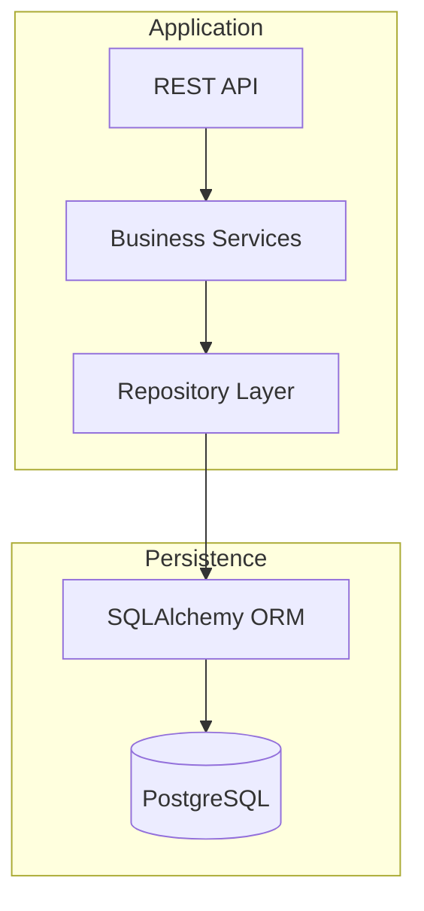
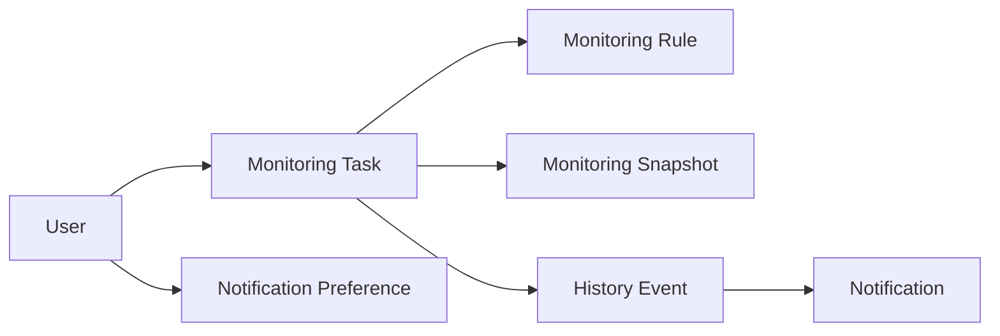

# WatchTower

# Database Design Document (DDD)

---

**Document Version:** 1.0 (Draft)

**Document Status:** Draft

**Prepared By:** Team WatchTower

**Related Documents**

- Software Requirements Specification (SRS)
- Software Architecture Design (SAD)
- API Specification

---

# 1. Introduction

## Chapter Overview

This document defines the logical and physical database design for WatchTower Version 1.0. It specifies the database architecture, entity relationships, table structures, constraints, indexing strategy, and integrity rules required to support the application's functionality.

The Database Design Document serves as the authoritative reference for implementing the persistence layer of WatchTower. It translates the domain model established in the Software Requirements Specification (SRS) and the architectural principles defined in the Software Architecture Design (SAD) into a structured relational database schema.

---

## 1.1 Purpose

The purpose of this document is to:

- Define the relational database schema for WatchTower.
- Document all business entities and their relationships.
- Specify table structures, constraints, and indexes.
- Ensure data consistency and integrity.
- Provide implementation guidance for SQLAlchemy models and database migrations.
- Serve as the primary reference for database development and maintenance.

---

## 1.2 Scope

This document includes:

- Database architecture
- Database design principles
- Naming conventions
- Entity Relationship Model (ERD)
- Table specifications
- Referential integrity rules
- Indexing strategy
- Transaction considerations
- Performance considerations
- Future database expansion

Application workflows, business rules, and API behavior are documented separately in the SRS and SAD.

---

## 1.3 Intended Audience

This document is intended for:

- Backend Developers
- Database Designers
- Software Architects
- Test Engineers
- Future Contributors

It assumes a basic understanding of relational databases and SQL.

---

## 1.4 Design Goals

The WatchTower database has been designed to achieve the following goals:

- Data integrity
- Normalized schema
- Efficient querying
- Predictable relationships
- Maintainability
- Scalability
- Support for future feature expansion

The database design prioritizes correctness and clarity while remaining optimized for the application's monitoring workload.

---

## Chapter Summary

This chapter introduced the purpose, scope, audience, and design objectives of the WatchTower database. The following chapter presents the overall database architecture and explains how the persistence layer fits within the application's architecture.

# 2. Database Architecture

---

## Chapter Overview

This chapter describes the overall database architecture of WatchTower and explains how the database integrates with the application's layered architecture. It defines the role of the persistence layer, the responsibilities of the database, and the principles governing data storage and access.

The database is designed to provide reliable, consistent, and efficient storage for all application data while maintaining a clear separation between business logic and persistence.

---

## 2.1 Database Overview

WatchTower uses a relational database management system (RDBMS) as the persistent storage layer.

The database is responsible for storing all business entities, maintaining relationships between them, preserving historical monitoring information, and supporting efficient retrieval of application data.

The persistence layer remains independent of the business layer through the Repository Pattern defined in the Software Architecture Design (SAD).

---

## 2.2 Database Architecture

The following diagram illustrates how the database fits within the overall application architecture.



### Architecture Description

The application never communicates directly with the database.

All database operations are routed through the Repository Layer, which uses SQLAlchemy ORM to translate business entities into relational database operations.

This architecture ensures that persistence concerns remain isolated from business logic.

---

## 2.3 Database Responsibilities

The database is responsible for the following functions:

- Persisting business entities.
- Maintaining relationships between entities.
- Preserving monitoring history.
- Supporting efficient querying.
- Enforcing referential integrity.
- Supporting concurrent application access.
- Maintaining transactional consistency.

Business rules and application workflows remain the responsibility of the Business Layer and are not enforced through database logic except where necessary to preserve data integrity.

---

## 2.4 Persistence Model

WatchTower adopts a normalized relational data model.

Each major business concept is represented by an independent table with clearly defined relationships.

The database schema is designed to minimize redundancy while maintaining efficient query performance.

### Persistence Model


flowchart LR
    AUTH[Authentication Service] -. "revocation lookup" .-> REVOKED[(revoked_tokens)]

### Persistence Characteristics

- Every entity has a clearly defined owner.
- Relationships are enforced through foreign keys.
- Business history is separated from operational data.
- User-specific data remains isolated.

---

## 2.5 Database Access Strategy

Database access follows a single controlled pathway.


### Access Principles

- Business Services shall never execute SQL statements directly.
- Repository classes shall encapsulate all persistence operations.
- SQLAlchemy ORM shall manage object-relational mapping.
- Database access shall remain transparent to higher architectural layers.

---

## 2.6 Database Characteristics

The WatchTower database exhibits the following architectural characteristics.

### Normalized Structure

Data redundancy is minimized through normalization and well-defined relationships.

---

### Strong Referential Integrity

Foreign key constraints maintain consistency between related entities.

---

### Historical Data Preservation

Permanent monitoring history is preserved independently from temporary operational observations.

---

### Modular Schema

Each business entity is represented by an independent table corresponding to a single domain concept.

---

### Extensible Design

The schema allows future entities and relationships to be introduced without significant restructuring.

---

## 2.7 Architectural Decisions

| ID | Decision | Rationale |
|----|----------|-----------|
| AD-DB-001 | PostgreSQL is selected as the primary database system. | Provides reliability, ACID compliance, and excellent ORM support. |
| AD-DB-002 | SQLAlchemy ORM is used as the persistence framework. | Simplifies object-relational mapping and improves maintainability. |
| AD-DB-003 | Repository Pattern isolates persistence logic. | Preserves separation of concerns. |
| AD-DB-004 | Business history is stored separately from operational monitoring data. | Supports long-term history while controlling database growth. |
| AD-DB-005 | All relationships are enforced using foreign key constraints. | Ensures referential integrity and data consistency. |

---

## Chapter Summary

This chapter introduced the database architecture of WatchTower, describing its role within the overall system, its persistence strategy, and the architectural principles governing database access and data storage.

The following chapter establishes the database design principles that guide schema design, normalization, integrity, and consistency throughout the database.

# 3. Database Design Principles

---

## Chapter Overview

This chapter establishes the fundamental principles that guide the design of the WatchTower database. These principles ensure consistency, maintainability, scalability, and data integrity throughout the application's lifecycle.

All database objects, relationships, and constraints defined in subsequent chapters adhere to these principles.

---

## 3.1 Design Objectives

The database has been designed to satisfy the following objectives:

- Ensure data integrity.
- Minimize redundancy.
- Maintain referential consistency.
- Support efficient query performance.
- Simplify maintenance and future expansion.
- Preserve historical monitoring information.
- Support transactional consistency.

---

## 3.2 Normalization

The database schema follows normalization principles to reduce redundancy and maintain data consistency.

The schema is designed primarily in **Third Normal Form (3NF)**.

Normalization provides the following benefits:

- Eliminates duplicate data.
- Simplifies updates.
- Reduces storage redundancy.
- Improves consistency.
- Simplifies maintenance.

Where appropriate, limited denormalization may be introduced in future versions to improve performance. Such changes shall be documented through an Architectural Decision Record (ADR).

---

## 3.3 Data Integrity

Data integrity is maintained through multiple mechanisms.

### Entity Integrity

Every table shall contain a primary key that uniquely identifies each record.

---

### Referential Integrity

Relationships between tables shall be enforced using foreign key constraints.

Invalid references shall not be permitted.

---

### Domain Integrity

Appropriate data types, default values, and constraints shall be used to ensure that stored values remain valid.

---

### Business Integrity

Business rules shall primarily be enforced within the application layer.

The database shall enforce only those rules necessary to preserve structural consistency.

---

## 3.4 Consistency Principles

The following principles govern database consistency.

- Every business entity shall have a unique identifier.
- Foreign key relationships shall remain valid.
- Orphan records shall not exist.
- Nullable fields shall be used only where semantically appropriate.
- Default values shall be defined where meaningful.
- Cascading operations shall be explicitly defined.

---

## 3.5 Data Separation

The database distinguishes between different categories of data.

| Category | Purpose |
|----------|---------|
| Configuration Data | User-defined settings and monitoring configuration. |
| Operational Data | Temporary runtime observations produced during monitoring. |
| Historical Data | Permanent records of detected changes. |
| Notification Data | Notification history and delivery records. |

Separating these categories improves maintainability and enables independent retention strategies.

---

## 3.6 Schema Modularity

Each table represents a single business concept.

The schema has been organized to ensure that:

- Tables have clearly defined responsibilities.
- Relationships remain predictable.
- Future entities can be added without restructuring the existing schema.
- Business concepts remain loosely coupled.

---

## 3.7 Architectural Decisions

| ID | Decision | Rationale |
|----|----------|-----------|
| AD-DP-001 | Database schema follows Third Normal Form (3NF). | Reduces redundancy and improves consistency. |
| AD-DP-002 | Business rules remain primarily within the application layer. | Preserves separation of concerns. |
| AD-DP-003 | Referential integrity is enforced through foreign keys. | Prevents inconsistent relationships. |
| AD-DP-004 | Operational and historical data remain separate. | Supports efficient storage management and retention policies. |

---

## Chapter Summary

This chapter established the database design principles that guide the schema of WatchTower. These principles ensure that the database remains consistent, maintainable, and extensible while supporting the application's functional and architectural requirements.

# 4. Naming Conventions

---

## Chapter Overview

This chapter defines the naming conventions adopted throughout the WatchTower database.

Consistent naming improves readability, maintainability, and collaboration while reducing ambiguity during development. These conventions apply to tables, columns, constraints, indexes, and other database objects.

---

## 4.1 General Conventions

The following conventions shall be followed throughout the database schema.

- Use lowercase names.
- Use `snake_case` for multi-word identifiers.
- Use descriptive names.
- Avoid abbreviations unless they are widely accepted.
- Use singular names for ORM model classes.
- Use plural names for database tables.

---

## 4.2 Table Naming

Database tables shall use **plural nouns**.

| Entity | Table Name |
|---------|------------|
| User | `users` |
| Monitoring Task | `monitoring_tasks` |
| Monitoring Rule | `monitoring_rules` |
| Monitoring Snapshot | `monitoring_snapshots` |
| History Event | `history_events` |
| Notification Preference | `notification_preferences` |
| Notification | `notifications` |
| Revoked Token | `revoked_tokens` |

---

## 4.3 Column Naming

Columns shall use descriptive `snake_case` names.

Primary keys shall use:

```text
id
```

Foreign keys shall follow the format:

```text
<referenced_entity>_id
```

### Examples

```text
user_id
task_id
history_event_id
created_at
updated_at
next_execution_at
```

---

## 4.4 Constraint Naming

Constraint names shall follow consistent prefixes.

| Constraint | Format |
|------------|--------|
| Primary Key | `pk_<table>` |
| Foreign Key | `fk_<table>_<referenced_table>` |
| Unique Constraint | `uq_<table>_<column>` |
| Check Constraint | `ck_<table>_<column>` |

---

## 4.5 Index Naming

Indexes shall use the following naming convention.

```text
idx_<table>_<column>
```

### Examples

```text
idx_monitoring_tasks_next_execution_at
idx_notifications_status
idx_history_events_created_at
```

---

## 4.6 Timestamp Columns

Business tables should include standard timestamp columns where applicable.

Standard timestamp columns:

```text
created_at
updated_at
```

Additional timestamps may be introduced when required.

Examples:

```text
last_checked_at
next_execution_at
deleted_at
```

---

## 4.7 Boolean Columns

Boolean fields shall use positive naming.

Examples:

```text
is_active
is_enabled
is_verified
is_deleted
```

Negative naming should be avoided whenever possible.

---

## 4.8 Architectural Decisions

| ID | Decision | Rationale |
|----|----------|-----------|
| AD-NC-001 | Database objects use `snake_case` naming. | Improves readability and consistency. |
| AD-NC-002 | Tables use plural nouns. | Aligns with common relational database conventions. |
| AD-NC-003 | Foreign keys follow the `<entity>_id` format. | Simplifies relationship identification. |
| AD-NC-004 | Constraints and indexes use standardized prefixes. | Improves maintainability and debugging. |

---

## Chapter Summary

This chapter established the naming conventions used throughout the WatchTower database. Consistent naming provides a predictable and maintainable structure that simplifies development and future database expansion.

# 5. Entity Relationship Model (ERM)

---

## Chapter Overview

This chapter presents the logical Entity Relationship Model (ERM) of the WatchTower database.

The ERM provides a conceptual representation of the database by identifying the major business entities and the relationships between them before individual tables are described.

---

## 5.1 Entity Overview

The WatchTower database consists of the following core entities.

| Entity | Purpose |
|---------|---------|
| User | Stores user account information. |
| Monitoring Task | Stores monitoring configurations. |
| Monitoring Rule | Stores monitoring conditions. |
| Monitoring Snapshot | Stores temporary monitoring observations. |
| History Event | Stores permanent records of detected changes. |
| Notification Preference | Stores user notification settings. |
| Notification | Stores notification history. |

---

## 5.2 Entity Relationship Diagram (ERD)

> **Insert the finalized ERD diagram here.**

The ERD illustrates the relationships between all entities and serves as the blueprint for the relational database schema.

---

## 5.3 Entity Categories

The database entities are grouped according to their functional responsibility.

| Category | Entities |
|----------|----------|
| User Management | User |
| Monitoring Configuration | Monitoring Task, Monitoring Rule |
| Monitoring Execution | Monitoring Snapshot |
| Historical Records | History Event |
| Notification Management | Notification Preference, Notification |

---

## 5.4 Ownership Hierarchy

```text
User
│
├── Monitoring Task
│      ├── Monitoring Rule
│      ├── Monitoring Snapshot
│      └── History Event
│              └── Notification
│
└── Notification Preference
```

This hierarchy illustrates the logical ownership of entities within the WatchTower database.

---

## 5.5 Aggregate Root

Within the monitoring domain, the **Monitoring Task** acts as the aggregate root.

All monitoring-related entities exist within the context of a Monitoring Task, ensuring consistent ownership and simplified lifecycle management.

---

## 5.6 Architectural Decisions

| ID | Decision | Rationale |
|----|----------|-----------|
| AD-ERM-001 | Monitoring Task is the aggregate root of the monitoring domain. | Simplifies ownership and lifecycle management. |
| AD-ERM-002 | Monitoring Snapshots and History Events remain separate entities. | Distinguishes operational data from permanent business history. |
| AD-ERM-003 | Notifications originate from History Events. | Preserves business event integrity and loose coupling. |

---

## Chapter Summary

This chapter introduced the logical Entity Relationship Model of WatchTower and established the ownership hierarchy that governs the database schema.

The following chapter defines the relationship rules that apply to these entities before detailing each table individually.

# 6. Relationship Rules

---

## Chapter Overview

This chapter defines the relationship rules governing the entities within the WatchTower database.

These rules establish ownership, cardinality, and lifecycle dependencies while ensuring referential integrity across the schema.

---

## 6.1 Relationship Summary

| Parent Entity | Child Entity | Cardinality |
|---------------|--------------|-------------|
| User | Monitoring Task | One-to-Many |
| User | Notification Preference | One-to-One |
| Monitoring Task | Monitoring Rule | One-to-Many |
| Monitoring Task | Monitoring Snapshot | One-to-Many |
| Monitoring Task | History Event | One-to-Many |
| History Event | Notification | One-to-Many |

---

## 6.2 Relationship Principles

The following principles apply to all entity relationships.

- Parent entities shall exist before child entities.
- Child entities shall reference a valid parent.
- Orphan records shall not exist.
- Relationship ownership shall remain unambiguous.
- Foreign key constraints shall enforce referential integrity.

---

## 6.3 Ownership Model

```text
User
│
├── Monitoring Task
│      ├── Monitoring Rule
│      ├── Monitoring Snapshot
│      └── History Event
│              └── Notification
│
└── Notification Preference
```

---

## 6.4 Cascade Strategy

Cascade operations shall be explicitly defined to maintain database consistency.

| Parent | Child | Cascade Delete |
|---------|-------|----------------|
| User | Monitoring Task | Yes |
| User | Notification Preference | Yes |
| Monitoring Task | Monitoring Rule | Yes |
| Monitoring Task | Monitoring Snapshot | Yes |
| Monitoring Task | History Event | Yes |
| History Event | Notification | Yes |

---

## 6.5 Optional Relationships

Certain relationships are intentionally optional.

Examples include:

- A Monitoring Snapshot may not produce a History Event if no meaningful change is detected.
- Notification records exist only when a notification is generated.

---

## 6.6 Architectural Decisions

| ID | Decision | Rationale |
|----|----------|-----------|
| AD-RR-001 | Foreign key constraints enforce all parent-child relationships. | Ensures referential integrity. |
| AD-RR-002 | Cascading deletes preserve schema consistency. | Prevents orphan records. |
| AD-RR-003 | Monitoring Snapshots may exist independently of History Events. | Supports efficient monitoring execution. |

---

## Chapter Summary

This chapter defined the relationship rules governing the WatchTower database, including ownership, cardinality, and cascade behavior.

These rules establish the structural integrity of the schema and provide the foundation for the detailed table specifications presented in the next chapter.

# 7. Table Specifications

---

## Chapter Overview

This chapter defines the physical schema of every table within the WatchTower database.

Each table specification describes its purpose, schema definition, constraints, relationships, indexes, and important implementation notes. Together, these specifications form the complete relational database schema for WatchTower Version 1.0.

The tables are documented in dependency order to improve readability and to clearly illustrate foreign key relationships.

---

## 7.1 Table Overview

| Table | Purpose |
|---------|---------|
| `users` | Stores registered user accounts. |
| `monitoring_tasks` | Stores monitoring configurations created by users. |
| `monitoring_rules` | Stores monitoring conditions associated with monitoring tasks. |
| `monitoring_snapshots` | Stores temporary monitoring observations generated during execution. |
| `history_events` | Stores permanent records of detected changes. |
| `notification_preferences` | Stores user notification configuration. |
| `notifications` | Stores generated notification records. |
| `revoked_tokens` | Stores revoked JWT identifiers to prevent further authentication with logged-out tokens. |

---

## 7.2 users

### Purpose

The `users` table stores account information for every registered user of WatchTower. It serves as the root entity for all user-owned data and is referenced by multiple tables throughout the database.

Each user represents an independent monitoring workspace with isolated monitoring tasks, notification preferences, and monitoring history.

---

### Schema Definition

| Column | Type | PK | FK | Nullable | Default | Description |
|---------|------|:--:|:--:|:--------:|---------|-------------|
| id | BIGSERIAL | ✓ | | ✗ | Auto Increment | Unique identifier for the user. |
| full_name | VARCHAR(100) | | | ✗ | — | Full name of the user. |
| email | VARCHAR(255) | | | ✗ | — | User email address. Must be unique. |
| password_hash | VARCHAR(255) | | | ✗ | — | Securely hashed user password. |
| is_verified | BOOLEAN | | | ✗ | FALSE | Indicates whether the email address has been verified. |
| is_active | BOOLEAN | | | ✗ | TRUE | Indicates whether the account is active. |
| created_at | TIMESTAMP WITH TIME ZONE | | | ✗ | CURRENT_TIMESTAMP | Timestamp when the account was created. |
| updated_at | TIMESTAMP WITH TIME ZONE | | | ✗ | CURRENT_TIMESTAMP | Timestamp of the most recent update. |

---

### Constraints

#### Primary Key

- `pk_users`

#### Unique Constraints

- Email address must be unique.

```text
uq_users_email
```

#### Check Constraints

- None

---

### Relationships

| Related Table | Relationship | Description |
|---------------|--------------|-------------|
| `monitoring_tasks` | One-to-Many | A user may create multiple monitoring tasks. |
| `notification_preferences` | One-to-One | Each user has one notification preference record. |

---

### Indexes

| Index | Columns | Purpose |
|--------|---------|---------|
| `uq_users_email` | email | Ensures email uniqueness and supports login lookups. |
| `idx_users_created_at` | created_at | Supports administrative reporting and future analytics. |

---

### Design Notes

- Email addresses are used as the primary login identifier.
- Passwords are never stored in plaintext.
- Passwords are stored exclusively as secure bcrypt hashes.
- User deletion cascades to all user-owned monitoring data as defined by the relationship rules.
- Audit timestamps support future reporting and activity tracking.

---

## 7.3 monitoring_tasks

### Purpose

The `monitoring_tasks` table stores the monitoring configurations created by users. Each record represents a single monitoring task that defines *what* should be monitored, *where* it should be monitored, and *when* monitoring should occur.

This table serves as the central entity of the monitoring domain and acts as the parent for monitoring rules, monitoring snapshots, and history events.

---

### Schema Definition

| Column | Type | PK | FK | Nullable | Default | Description |
|---------|------|----|----|----------|---------|-------------|
| id | BIGSERIAL | Yes | No | No | Auto Increment | Unique identifier for the monitoring task. |
| user_id | BIGINT | No | Yes | No | — | References the owner in the `users` table. |
| name | VARCHAR(150) | No | No | No | — | User-defined name of the monitoring task. |
| description | TEXT | No | No | Yes | NULL | Optional description of the monitoring task. |
| target_url | TEXT | No | No | No | — | URL of the webpage or resource to be monitored. |
| check_interval | INTEGER | No | No | No | 60 | Monitoring interval in minutes. |
| is_active | BOOLEAN | No | No | No | TRUE | Indicates whether the monitoring task is active. |
| last_checked_at | TIMESTAMP WITH TIME ZONE | No | No | Yes | NULL | Timestamp of the most recent monitoring execution. |
| next_execution_at | TIMESTAMP WITH TIME ZONE | No | No | Yes | NULL | Scheduled time for the next monitoring execution. |
| created_at | TIMESTAMP WITH TIME ZONE | No | No | No | CURRENT_TIMESTAMP | Record creation timestamp. |
| updated_at | TIMESTAMP WITH TIME ZONE | No | No | No | CURRENT_TIMESTAMP | Timestamp of the last update. |

---

### Constraints

| Type | Name |
|------|------|
| Primary Key | `pk_monitoring_tasks` |
| Foreign Key | `fk_monitoring_tasks_users` |

---

### References

| Column | References |
|---------|------------|
| `user_id` | `users.id` |

---

### Referenced By

| Table | Foreign Key |
|---------|-------------|
| `monitoring_rules` | `task_id` |
| `monitoring_snapshots` | `task_id` |
| `history_events` | `task_id` |

---

### Indexes

| Index | Columns | Purpose |
|---------|----------|----------|
| `idx_monitoring_tasks_user_id` | `user_id` | Supports retrieval of tasks belonging to a user. |
| `idx_monitoring_tasks_next_execution_at` | `next_execution_at` | Optimizes scheduler queries for pending monitoring tasks. |
| `idx_monitoring_tasks_is_active` | `is_active` | Supports filtering of active monitoring tasks. |

---

### Design Notes

- Each monitoring task belongs to exactly one user.
- The `next_execution_at` column is used by the scheduler to determine execution order.
- Deleting a monitoring task cascades to its associated monitoring rules, snapshots, and history events.
- The table represents the aggregate root of the monitoring domain.

---

## 7.4 monitoring_rules

### Purpose

The `monitoring_rules` table stores the monitoring conditions associated with a monitoring task. Each rule defines a specific condition that is evaluated during every monitoring cycle to determine whether a meaningful change has occurred.

A monitoring task may contain multiple rules, allowing users to monitor different aspects of the same target resource independently.

---

### Schema Definition

| Column | Type | PK | FK | Nullable | Default | Description |
|---------|------|----|----|----------|---------|-------------|
| id | BIGSERIAL | Yes | No | No | Auto Increment | Unique identifier for the monitoring rule. |
| task_id | BIGINT | No | Yes | No | — | References the associated monitoring task. |
| rule_type | VARCHAR(50) | No | No | No | — | Type of monitoring rule (e.g., Price, Stock, Keyword). |
| operator | VARCHAR(20) | No | No | No | — | Comparison operator used during evaluation. |
| target_value | TEXT | No | No | No | — | Expected value or threshold used for comparison. |
| is_enabled | BOOLEAN | No | No | No | TRUE | Indicates whether the rule is active. |
| created_at | TIMESTAMP WITH TIME ZONE | No | No | No | CURRENT_TIMESTAMP | Record creation timestamp. |
| updated_at | TIMESTAMP WITH TIME ZONE | No | No | No | CURRENT_TIMESTAMP | Timestamp of the last update. |

---

### Constraints

| Type | Name |
|------|------|
| Primary Key | `pk_monitoring_rules` |
| Foreign Key | `fk_monitoring_rules_monitoring_tasks` |

---

### References

| Column | References |
|---------|------------|
| `task_id` | `monitoring_tasks.id` |

---

### Referenced By

| Table | Foreign Key |
|---------|-------------|
| — | None |

---

### Indexes

| Index | Columns | Purpose |
|---------|----------|----------|
| `idx_monitoring_rules_task_id` | `task_id` | Supports retrieval of rules for a monitoring task. |
| `idx_monitoring_rules_rule_type` | `rule_type` | Supports filtering and evaluation by rule type. |

---

### Design Notes

- A monitoring task may contain multiple monitoring rules.
- Rules are evaluated independently during each monitoring cycle.
- The schema is intentionally generic to support future monitoring strategies without structural changes.
- Disabled rules are ignored during monitoring execution.
- New rule types may be introduced without modifying the database schema.

---

## 7.5 monitoring_snapshots

### Purpose

The `monitoring_snapshots` table stores the observed state of a monitored resource at the time of a monitoring execution.

Snapshots serve as operational data used by the Monitoring Engine to compare successive executions and determine whether a meaningful change has occurred. They are temporary in nature and may be removed according to the application's data retention policy.

---

### Schema Definition

| Column | Type | PK | FK | Nullable | Default | Description |
|---------|------|----|----|----------|---------|-------------|
| id | BIGSERIAL | Yes | No | No | Auto Increment | Unique identifier for the monitoring snapshot. |
| task_id | BIGINT | No | Yes | No | — | References the associated monitoring task. |
| snapshot_data | JSONB | No | No | No | — | Stores the extracted monitoring data captured during execution. |
| content_hash | VARCHAR(64) | No | No | No | — | Hash of the snapshot content used for efficient change detection. |
| execution_status | VARCHAR(30) | No | No | No | 'SUCCESS' | Status of the monitoring execution. |
| response_time_ms | INTEGER | No | No | Yes | NULL | Time taken to complete the monitoring request in milliseconds. |
| captured_at | TIMESTAMP WITH TIME ZONE | No | No | No | CURRENT_TIMESTAMP | Timestamp when the snapshot was captured. |

---

### Constraints

| Type | Name |
|------|------|
| Primary Key | `pk_monitoring_snapshots` |
| Foreign Key | `fk_monitoring_snapshots_monitoring_tasks` |

---

### References

| Column | References |
|---------|------------|
| `task_id` | `monitoring_tasks.id` |

---

### Referenced By

| Column | References |
|---------|------------|
| — | None |

---

### Indexes

| Index | Columns | Purpose |
|---------|----------|----------|
| `idx_monitoring_snapshots_task_id` | `task_id` | Supports retrieval of snapshots for a monitoring task. |
| `idx_monitoring_snapshots_captured_at` | `captured_at` | Supports chronological retrieval and cleanup operations. |
| `idx_monitoring_snapshots_content_hash` | `content_hash` | Optimizes snapshot comparison during monitoring execution. |

---

### Design Notes

- Snapshots represent operational monitoring data rather than permanent business history.
- The `snapshot_data` column stores structured monitoring results using the PostgreSQL `JSONB` data type.
- The `content_hash` enables efficient comparison between consecutive snapshots without repeatedly processing large datasets.
- Snapshot records may be automatically removed according to the configured retention policy.
- Permanent changes detected during comparison are recorded separately in the `history_events` table.

---

### Purpose

The `monitoring_snapshots` table stores the observed state of a monitored resource at the time of a monitoring execution.

Snapshots serve as operational data used by the Monitoring Engine to compare successive executions and determine whether a meaningful change has occurred. They are temporary in nature and may be removed according to the application's data retention policy.

---

### Schema Definition

| Column | Type | PK | FK | Nullable | Default | Description |
|---------|------|----|----|----------|---------|-------------|
| id | BIGSERIAL | Yes | No | No | Auto Increment | Unique identifier for the monitoring snapshot. |
| task_id | BIGINT | No | Yes | No | — | References the associated monitoring task. |
| snapshot_data | JSONB | No | No | No | — | Stores the extracted monitoring data captured during execution. |
| content_hash | VARCHAR(64) | No | No | No | — | Hash of the snapshot content used for efficient change detection. |
| execution_status | VARCHAR(30) | No | No | No | 'SUCCESS' | Status of the monitoring execution. |
| response_time_ms | INTEGER | No | No | Yes | NULL | Time taken to complete the monitoring request in milliseconds. |
| captured_at | TIMESTAMP WITH TIME ZONE | No | No | No | CURRENT_TIMESTAMP | Timestamp when the snapshot was captured. |

---

### Constraints

| Type | Name |
|------|------|
| Primary Key | `pk_monitoring_snapshots` |
| Foreign Key | `fk_monitoring_snapshots_monitoring_tasks` |

---

### References

| Column | References |
|---------|------------|
| `task_id` | `monitoring_tasks.id` |

---

### Referenced By

| Column | References |
|---------|------------|
| — | None |

---

### Indexes

| Index | Columns | Purpose |
|---------|----------|----------|
| `idx_monitoring_snapshots_task_id` | `task_id` | Supports retrieval of snapshots for a monitoring task. |
| `idx_monitoring_snapshots_captured_at` | `captured_at` | Supports chronological retrieval and cleanup operations. |
| `idx_monitoring_snapshots_content_hash` | `content_hash` | Optimizes snapshot comparison during monitoring execution. |

---

### Design Notes

- Snapshots represent operational monitoring data rather than permanent business history.
- The `snapshot_data` column stores structured monitoring results using the PostgreSQL `JSONB` data type.
- The `content_hash` enables efficient comparison between consecutive snapshots without repeatedly processing large datasets.
- Snapshot records may be automatically removed according to the configured retention policy.
- Permanent changes detected during comparison are recorded separately in the `history_events` table.

---

## 7.6 history_events

### Purpose

The `history_events` table stores permanent records of meaningful changes detected during monitoring.

Unlike `monitoring_snapshots`, which represent temporary operational observations, history events represent significant business events that are preserved for auditing, reporting, user notifications, and historical analysis.

A history event is created only when the Monitoring Engine determines that one or more monitoring rules have been satisfied.

---

### Schema Definition

| Column | Type | PK | FK | Nullable | Default | Description |
|---------|------|----|----|----------|---------|-------------|
| id | BIGSERIAL | Yes | No | No | Auto Increment | Unique identifier for the history event. |
| task_id | BIGINT | No | Yes | No | — | References the associated monitoring task. |
| rule_id | BIGINT | No | Yes | No | — | References the monitoring rule that triggered the event. |
| snapshot_id | BIGINT | No | Yes | No | — | References the snapshot that produced the event. |
| event_type | VARCHAR(50) | No | No | No | — | Type of detected event (e.g., Price Drop, Stock Available). |
| previous_value | TEXT | No | No | Yes | NULL | Previous observed value. |
| current_value | TEXT | No | No | Yes | NULL | Newly observed value. |
| event_message | TEXT | No | No | Yes | NULL | Human-readable description of the detected change. |
| detected_at | TIMESTAMP WITH TIME ZONE | No | No | No | CURRENT_TIMESTAMP | Timestamp when the event was detected. |

---

### Constraints

| Type | Name |
|------|------|
| Primary Key | `pk_history_events` |
| Foreign Key | `fk_history_events_monitoring_tasks` |
| Foreign Key | `fk_history_events_monitoring_rules` |
| Foreign Key | `fk_history_events_monitoring_snapshots` |

---

### References

| Column | References |
|---------|------------|
| `task_id` | `monitoring_tasks.id` |
| `rule_id` | `monitoring_rules.id` |
| `snapshot_id` | `monitoring_snapshots.id` |

---

### Referenced By

| Table | Foreign Key |
|---------|-------------|
| `notifications` | `history_event_id` |

---

### Indexes

| Index | Columns | Purpose |
|---------|----------|----------|
| `idx_history_events_task_id` | `task_id` | Supports retrieval of history for a monitoring task. |
| `idx_history_events_detected_at` | `detected_at` | Supports chronological sorting and reporting. |
| `idx_history_events_rule_id` | `rule_id` | Supports filtering by monitoring rule. |

---

### Design Notes

- History events are permanent business records and are not subject to automatic cleanup.
- Every history event is associated with exactly one monitoring task, one monitoring rule, and one monitoring snapshot.
- The `event_message` stores a user-friendly description for notifications and history views.
- Notifications are generated from history events rather than directly from monitoring snapshots.
- History events form the audit trail of the monitoring system.

---

## 7.7 notification_preferences

### Purpose

The `notification_preferences` table stores each user's notification configuration.

It defines the preferred notification channels and delivery settings used by the Notification Service when generating user notifications.

Each user has exactly one notification preference record.

---

### Schema Definition

| Column | Type | PK | FK | Nullable | Default | Description |
|---------|------|----|----|----------|---------|-------------|
| id | BIGSERIAL | Yes | No | No | Auto Increment | Unique identifier for the notification preference. |
| user_id | BIGINT | No | Yes | No | — | References the associated user. |
| email_enabled | BOOLEAN | No | No | No | TRUE | Enables email notifications. |
| browser_push_enabled | BOOLEAN | No | No | No | TRUE | Enables browser push notifications. |
| notify_on_price_change | BOOLEAN | No | No | No | TRUE | Enables notifications for price-related events. |
| notify_on_stock_change | BOOLEAN | No | No | No | TRUE | Enables notifications for stock-related events. |
| created_at | TIMESTAMP WITH TIME ZONE | No | No | No | CURRENT_TIMESTAMP | Record creation timestamp. |
| updated_at | TIMESTAMP WITH TIME ZONE | No | No | No | CURRENT_TIMESTAMP | Timestamp of the last update. |

---

### Constraints

| Type | Name |
|------|------|
| Primary Key | `pk_notification_preferences` |
| Foreign Key | `fk_notification_preferences_users` |
| Unique | `uq_notification_preferences_user_id` |

---

### References

| Column | References |
|---------|------------|
| `user_id` | `users.id` |

---

### Referenced By

| Column | References |
|---------|------------|
| — | None |

---

### Indexes

| Index | Columns | Purpose |
|---------|----------|----------|
| `uq_notification_preferences_user_id` | `user_id` | Ensures one preference record per user and supports efficient retrieval. |

---

### Design Notes

- Each user owns exactly one notification preference record.
- Notification preferences determine delivery behavior but do not affect monitoring execution.
- Additional notification channels can be introduced without modifying existing records.
- Default values ensure users receive notifications immediately after account creation.

---

## 7.8 notifications

### Purpose

The `notifications` table stores notifications generated from history events.

Each notification represents a delivery attempt or delivered message through one or more supported notification channels. Notification records provide delivery history, status tracking, and auditing of user notifications.

---

### Schema Definition

| Column | Type | PK | FK | Nullable | Default | Description |
|---------|------|----|----|----------|---------|-------------|
| id | BIGSERIAL | Yes | No | No | Auto Increment | Unique identifier for the notification. |
| history_event_id | BIGINT | No | Yes | No | — | References the associated history event. |
| notification_channel | VARCHAR(30) | No | No | No | — | Delivery channel (Email, Browser Push, etc.). |
| notification_status | VARCHAR(30) | No | No | No | 'PENDING' | Current delivery status. |
| delivered_at | TIMESTAMP WITH TIME ZONE | No | No | Yes | NULL | Timestamp when the notification was successfully delivered. |
| error_message | TEXT | No | No | Yes | NULL | Error details if delivery fails. |
| created_at | TIMESTAMP WITH TIME ZONE | No | No | No | CURRENT_TIMESTAMP | Record creation timestamp. |

---

### Constraints

| Type | Name |
|------|------|
| Primary Key | `pk_notifications` |
| Foreign Key | `fk_notifications_history_events` |

---

### References

| Column | References |
|---------|------------|
| `history_event_id` | `history_events.id` |

---

### Referenced By

| Column | References |
|---------|------------|
| — | None |

---

### Indexes

| Index | Columns | Purpose |
|---------|----------|----------|
| `idx_notifications_history_event_id` | `history_event_id` | Supports retrieval of notifications for a history event. |
| `idx_notifications_status` | `notification_status` | Supports processing of pending and failed notifications. |
| `idx_notifications_created_at` | `created_at` | Supports chronological notification history. |

---

### Design Notes

- Notifications are created only after a History Event has been successfully recorded.
- Multiple notifications may exist for a single History Event when multiple delivery channels are enabled.
- Delivery status is tracked independently for each notification.
- Failed notification attempts remain stored for auditing and retry purposes.
- Notification records are independent of monitoring execution and do not affect monitoring results.

---

## 7.9 revoked_tokens

### Purpose

The `revoked_tokens` table stores identifiers of revoked JWT access tokens. It allows the authentication layer to reject a token after the user logs out, even if the token has not yet expired.

Each record represents one revoked token. Revocation records are retained until the associated token expires, after which they may be removed by a cleanup process.

---

### Schema Definition

| Column | Type | PK | FK | Nullable | Default | Description |
|---------|------|:--:|:--:|:--------:|---------|-------------|
| id | BIGSERIAL | ✓ | | ✗ | Auto Increment | Unique identifier for the revocation record. |
| jti | VARCHAR(32) | | | ✗ | — | Unique JWT identifier used to identify the revoked token. |
| expires_at | TIMESTAMP WITH TIME ZONE | | | ✗ | — | Expiration timestamp of the associated JWT. |
| created_at | TIMESTAMP WITH TIME ZONE | | | ✗ | CURRENT_TIMESTAMP | Timestamp when the token was revoked. |

---

### Constraints

**Primary Key**
- `pk_revoked_tokens`

**Unique Constraint**
- `uq_revoked_tokens_jti` — Ensures that a token identifier is recorded only once.

### Relationships

This table has no foreign key relationship to `users`. Revocation is associated with an individual token identifier rather than a user account.

### Indexes

| Index | Columns | Purpose |
|---------|---------|---------|
| `uq_revoked_tokens_jti` | `jti` | Enforces uniqueness and supports token-revocation lookups. |
| `idx_revoked_tokens_expires_at` | `expires_at` | Supports cleanup of expired revocation records. |

### Design Notes

- JWTs must contain a unique `jti` claim for revocation checks.
- A token shall be rejected if its `jti` exists in this table.
- Token expiration must still be validated independently of revocation status.
- Revocation records may be deleted after their corresponding tokens expire.
- Revocation checks must be performed as part of authentication for protected resources.
- The table supports revoking the current session's access token without revoking tokens issued to other sessions.

---

# 8. Referential Integrity

---

## Chapter Overview

This chapter defines the referential integrity rules that maintain consistency across the WatchTower database.

Foreign key constraints ensure that relationships between entities remain valid throughout the lifecycle of the application.

---

## 8.1 Referential Integrity Principles

The database enforces the following principles:

- Every foreign key shall reference a valid parent record.
- Orphan records shall not exist.
- Parent-child relationships shall remain consistent.
- Referential integrity shall be enforced at the database level.

---

## 8.2 Foreign Key Relationships

| Parent Table | Child Table | Foreign Key |
|--------------|-------------|-------------|
| `users` | `monitoring_tasks` | `user_id` |
| `users` | `notification_preferences` | `user_id` |
| `monitoring_tasks` | `monitoring_rules` | `task_id` |
| `monitoring_tasks` | `monitoring_snapshots` | `task_id` |
| `monitoring_tasks` | `history_events` | `task_id` |
| `monitoring_rules` | `history_events` | `rule_id` |
| `monitoring_snapshots` | `history_events` | `snapshot_id` |
| `history_events` | `notifications` | `history_event_id` |

---

## 8.3 Cascade Delete Policy

| Parent Table | Child Table | Delete Action |
|--------------|-------------|---------------|
| `users` | `monitoring_tasks` | CASCADE |
| `users` | `notification_preferences` | CASCADE |
| `monitoring_tasks` | `monitoring_rules` | CASCADE |
| `monitoring_tasks` | `monitoring_snapshots` | CASCADE |
| `monitoring_tasks` | `history_events` | CASCADE |
| `history_events` | `notifications` | CASCADE |

---

## 8.4 Update Policy

Primary key values shall remain immutable.

Foreign key updates are managed by the application layer and shall preserve referential integrity.

---

## Chapter Summary

The WatchTower database maintains strong referential integrity through foreign key constraints and explicitly defined cascade policies.

# 9. Indexing Strategy

---

## Chapter Overview

This chapter describes the indexing strategy adopted to improve query performance while minimizing storage overhead.

Indexes have been defined based on anticipated application access patterns.

---

## 9.1 Indexing Principles

The indexing strategy follows these principles:

- Index frequently queried columns.
- Avoid unnecessary indexes.
- Support scheduler operations.
- Optimize user-specific queries.
- Maintain efficient historical lookups.

---

## 9.2 Primary Indexes

Every table includes a primary key index.

---

## 9.3 Secondary Indexes

| Table | Indexed Column(s) | Purpose |
|---------|------------------|----------|
| `users` | `email` | Authentication |
| `monitoring_tasks` | `user_id` | User dashboard |
| `monitoring_tasks` | `next_execution_at` | Scheduler |
| `monitoring_tasks` | `is_active` | Active monitoring |
| `monitoring_rules` | `task_id` | Rule retrieval |
| `monitoring_snapshots` | `task_id` | Snapshot retrieval |
| `monitoring_snapshots` | `captured_at` | Chronological queries |
| `history_events` | `task_id` | History retrieval |
| `history_events` | `detected_at` | Timeline sorting |
| `notifications` | `notification_status` | Notification processing |

---

## 9.4 Future Optimization

Additional indexes may be introduced based on production query analysis without affecting the logical schema.

---

## Chapter Summary

The indexing strategy prioritizes efficient scheduling, monitoring, and historical data retrieval while avoiding excessive indexing overhead.

# 10. Transaction Strategy

---

## Chapter Overview

This chapter defines how database transactions are managed to ensure data consistency during application operations.

---

## 10.1 Transaction Principles

The application follows ACID transaction principles.

Database transactions shall ensure:

- Atomicity
- Consistency
- Isolation
- Durability

---

## 10.2 Transaction Scope

Transactions shall be used for operations that modify multiple related entities.

Examples include:

- Creating a monitoring task and its associated rules.
- Recording a history event and generating notifications.
- Deleting a monitoring task and all dependent entities.

---

## 10.3 Error Handling

If any operation within a transaction fails, the entire transaction shall be rolled back.

No partial updates shall be committed.

---

## Chapter Summary

Transactional consistency ensures reliable execution of business operations and preserves database integrity.

# 11. Performance Considerations

---

## Chapter Overview

This chapter outlines the primary performance considerations incorporated into the WatchTower database design.

---

## 11.1 Query Performance

The database has been optimized for:

- User dashboard queries.
- Monitoring scheduler execution.
- Historical event retrieval.
- Notification processing.

---

## 11.2 Storage Strategy

Operational monitoring data and permanent business history are stored separately.

This separation enables efficient data retention and minimizes unnecessary database growth.

---

## 11.3 Scalability

The database schema supports future expansion by:

- Maintaining normalized relationships.
- Using generic monitoring rules.
- Storing flexible monitoring data using `JSONB`.
- Supporting additional monitoring strategies without schema modifications.

---

## 11.4 Future Enhancements

Potential future optimizations include:

- Table partitioning.
- Read replicas.
- Materialized views.
- Query caching.

These enhancements can be introduced without changing the logical schema.

---

## Chapter Summary

The WatchTower database has been designed to provide reliable performance while remaining scalable for future application growth.

# 12. Future Expansion

---

## Chapter Overview

This chapter identifies areas where the database may evolve in future versions of WatchTower while preserving the current architectural foundation.

---

## 12.1 Planned Enhancements

Potential future enhancements include:

- Additional monitoring strategies.
- More notification channels.
- Team workspaces.
- Shared monitoring tasks.
- Monitoring templates.
- Analytics dashboards.
- Scheduled reports.
- Multi-language notifications.

---

## 12.2 Database Evolution

The database schema has been designed to support future expansion through:

- Generic monitoring rules.
- Flexible `JSONB` snapshot storage.
- Modular entity relationships.
- Normalized schema design.

Future enhancements should extend the schema without requiring significant structural redesign.

---

## Chapter Summary

The current database design provides a stable foundation while allowing WatchTower to evolve through future feature additions with minimal schema modifications.

---

# Document Conclusion

This Database Design Document defines the logical and physical database structure of WatchTower Version 1.0.

Together with the Software Requirements Specification (SRS) and Software Architecture Design (SAD), it serves as the primary reference for implementing the persistence layer, SQLAlchemy models, database migrations, and repository layer.

The database has been designed to prioritize data integrity, maintainability, scalability, and extensibility while remaining aligned with the architectural principles established throughout the project.

**End of Document**